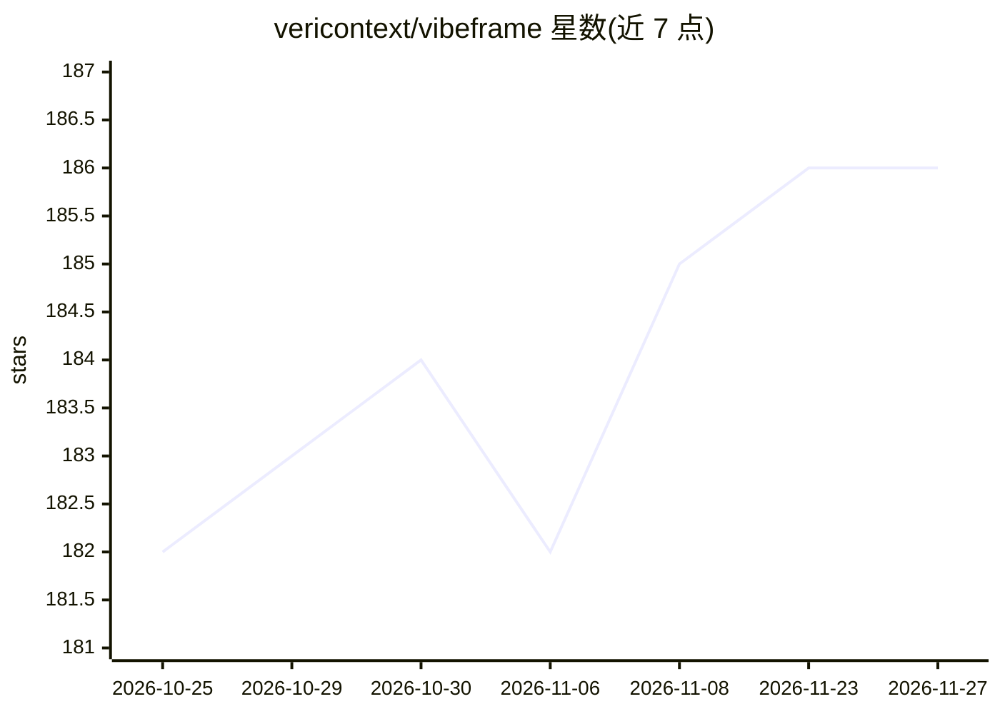

# vericontext/vibeframe

⭐ 186 · TypeScript · MIT · 推送 2026-11-15 · [GitHub](https://github.com/vericontext/vibeframe) · [官网](https://vibeframe.ai) · 组织维护

**让编码 agent 在自有密钥与花费上限下生成真实视频的 CLI+MCP 工具**

面向 Claude Code、Codex、Cursor 等可执行 bash 的编码 agent，VibeFrame 提供 CLI 与 MCP 服务器两种接入方式：把书面 brief 转成计划，调用 Seedance、Grok、Runway、Kling、Gemini Omni 等模型生成图像/视频资产并渲染为 MP4。关键机制包括：--dry-run 预先计价、--max-cost 硬性花费上限、每次生成记录为带成本来源的 take、失败时返回 JSON 恢复动作。角色池机制可在多场景保持同一角色形象。无密钥时走本地 $0 路径（Kokoro 旁白+HTML/CSS 场景+FFmpeg）。生成环节才需要 API key。

## 筛选速览

| 维度 | 判定 | 备注 |
|---|---|---|
| AI 角色 | `ai-native` | 本体是模型或模型工具 |
| 许可风险 | `permissive` | MIT |
| 部署形态 | `library` | 以包/库形式分发 |
| 模型依赖 | — | README 未给出锁定关系 |
| 硬件要求 | — | 无带数字的原话,不猜 |
| 安装摩擦 | `medium` | 含编译或系统依赖之一 |
| 成熟度 | — | 结构信号不足 |

## 能力要点

- --dry-run 计价 + --max-cost 硬性花费上限，超限拒绝启动
- 每次生成保存为 take：提示词、文件哈希、provider 任务与成本
- 角色池机制：角色表生成一次，各场景关键帧由此编辑保持一致
- CLI 为主运行时，另提供 MCP 服务器与 Claude Desktop 扩展（mcpb）

## 适用场景

- 让编码 agent 按预算上限自动生成宣传或演示视频
- 先 dry-run 估价再决定是否向 provider 注册付费
- 多场景视频保持同一角色形象一致
- 无密钥时用本地路径先体验工作流

## 场景标签

`视频生成` `语音合成` · 领域:内容生成

## 证据(README 行号)

> L5: VibeFrame is a CLI and MCP server for Claude Code, Codex, Cursor, or any bash-capable agent.
> L6: It turns a written brief into a plan, generates the assets with frontier models (Seedance, Grok, Runway, Kling, Gemi
> L7: Every paid step has a dry run and a hard `--max-cost` ceiling.

## 星数曲线

2026-10-25 182 → 2026-11-27 186（+4）

---
*卡片 v1 · prompt 1.4 · 生成 2026-11-26 · 置信度 mid · 依据 README sha `1c20bdc7084c` · [字段定义](../../DATASET.md)*
