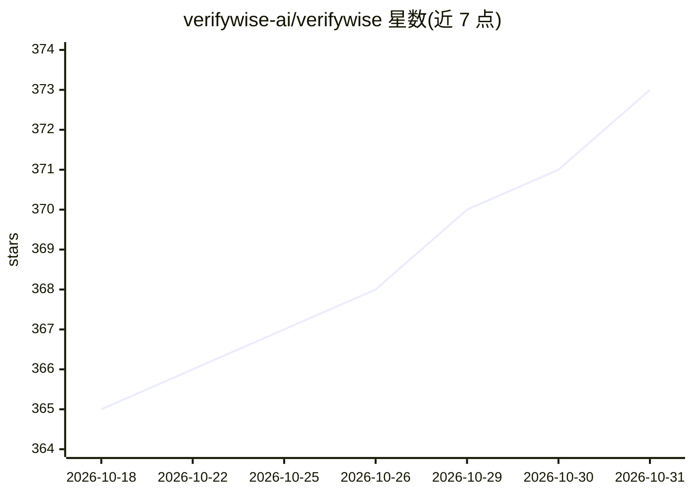

# verifywise-ai/verifywise

⭐ 373 · TypeScript · NOASSERTION · 推送 2026-10-30 · [GitHub](https://github.com/verifywise-ai/verifywise) · [官网](https://verifywise.ai) · 组织维护

**面向企业的 AI 治理与合规审计平台，支持 25 个合规框架**

源码可用的 AI 治理平台（VCEL 1.0 许可）：支持 EU AI Act、ISO 42001、NIST AI RMF、ISO 27001 等 25 个合规框架，提供 LLM 评测（LLM Evals/Arena）、AI 生成答案加速合规审计、模型清单与风险、厂商风险管理、AI 事件管理、影子 AI 检测、AI 代码生成内容检测、策略管理与 PDF/DOCX 报告导出。可本地部署或私有云部署，采用 React 前端 + Node 后端 + PostgreSQL + Python EvalServer，支持 npm 开发安装与 Docker/Kubernetes 生产部署。个人、教育、公共部门与非商业研究免费，企业商业使用需商业许可（60 天评估期）。

## 筛选速览

| 维度 | 判定 | 备注 |
|---|---|---|
| AI 角色 | `ai-ecosystem` | LLM/agent 周边工具 |
| 许可风险 | `none` | NOASSERTION |
| 部署形态 | `self-host` | docker 或自建部署 |
| 模型依赖 | — | README 未给出锁定关系 |
| 硬件要求 | — | 无带数字的原话,不猜 |
| 安装摩擦 | `low` | 无编译、无系统依赖或容器化 |
| 成熟度 | — | 结构信号不足 |

## 能力要点

- 25 个内置合规框架（EU AI Act/ISO 42001/NIST AI RMF/SOC 2/GDPR 等）
- LLM Evals 与 LLM Arena 评测功能（独立 Python EvalServer）
- AI Advisor 治理建议聊天界面与影子 AI 检测
- 本地部署、RBAC、审批工作流、事件日志与报告导出

## 适用场景

- 企业按 EU AI Act / ISO 42001 等框架开展 AI 合规审计
- 对使用的 LLM 与模型做评测与风险登记管理
- 管理 AI 厂商、事件、内部策略与信任中心披露

## 场景标签

`模型评测` · 领域:评测与运维

## 证据(README 行号)

> L14: VerifyWise is a source available AI governance platform designed to help businesses use the power of AI safely and 
> L61: - Faster audits using AI-generated answers for compliance and assessment questions
> L71:  - Complete LLM Evals and LLM Arena

## 星数曲线

2026-10-18 365 → 2026-10-31 373（+8）

---
*卡片 v1 · prompt 1.4 · 生成 2026-10-22 · 置信度 mid · 依据 README sha `bb5deede879f` · [字段定义](../../DATASET.md)*
