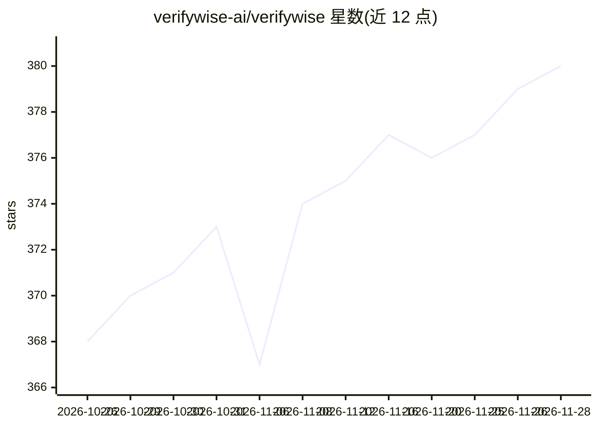

# verifywise-ai/verifywise

⭐ 380 · TypeScript · NOASSERTION · 推送 2026-11-27 · [GitHub](https://github.com/verifywise-ai/verifywise) · [官网](https://verifywise.ai) · 组织维护

**面向企业的 AI 治理与合规管理平台，覆盖 EU AI Act 等框架**

VerifyWise 是一个 source-available 的 AI 治理平台，供企业管理 AI 使用场景、风险、模型清单、供应商风险、政策与事件，并支持 EU AI Act、ISO 42001、NIST AI RMF 等 29 个内置合规框架与 LLM Evals/Arena。架构为 React 前端 + Node.js 后端 + PostgreSQL/Redis，另有 Python 的 EvalServer 处理评估；AI 功能包括生成合规问题答案、治理建议聊天（AI Advisor）与代码库 AI 生成内容检测。支持本地/私有云部署与 RBAC。许可为 VCEL 1.1：个人使用免费，组织超过 60 天评估需购买许可。

## 筛选速览

| 维度 | 判定 | 备注 |
|---|---|---|
| AI 角色 | `ai-enhanced` | 去掉 AI 部分产品仍成立 |
| 许可风险 | `none` | NOASSERTION |
| 部署形态 | `self-host` | docker 或自建部署 |
| 模型依赖 | — | README 未给出锁定关系 |
| 硬件要求 | — | 无带数字的原话,不猜 |
| 安装摩擦 | `low` | 无编译、无系统依赖或容器化 |
| 成熟度 | — | 结构信号不足 |

## 能力要点

- 29 个内置合规框架（EU AI Act、ISO 42001、NIST AI RMF、SOC 2、GDPR 等）
- LLM Evals 与 LLM Arena，评估由 Python EvalServer 承载
- AI Advisor 治理建议聊天与代码库 AI 生成内容检测模块
- 支持本地/私有云、Docker/Kubernetes 部署及 RBAC

## 适用场景

- 为企业 AI 使用场景建立风险与合规台账，对接 EU AI Act 等法规
- 集中管理公司内部 AI 政策、供应商风险与事件记录
- 对使用中的 LLM 运行评估并在平台内留档

## 场景标签

`模型评测` · 领域:评测与运维

## 证据(README 行号)

> L12: VerifyWise is a source available AI governance platform designed to help businesses use the power of AI safely and 
> L59: - Faster audits using AI-generated answers for compliance and assessment questions
> L69:  - Complete LLM Evals and LLM Arena

## 星数曲线

2026-10-26 368 → 2026-11-28 380（+12）

---
*卡片 v1 · prompt 1.4 · 生成 2026-11-28 · 置信度 high · 依据 README sha `33daba5a8212` · [字段定义](../../DATASET.md)*
