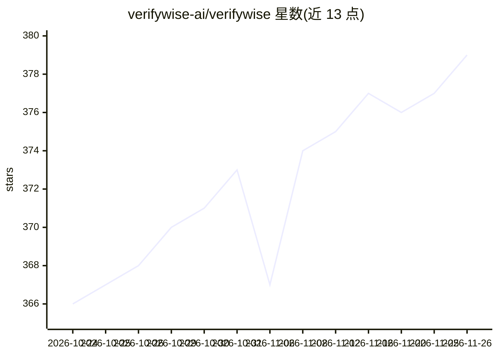

# verifywise-ai/verifywise

⭐ 379 · TypeScript · NOASSERTION · 推送 2026-11-25 · [GitHub](https://github.com/verifywise-ai/verifywise) · [官网](https://verifywise.ai) · 组织维护

**企业AI治理与合规平台：对接EU AI Act等框架并做LLM评测**

VerifyWise 是可本地部署的开源可用（source-available）AI 治理平台，面向需要在组织内落地 AI 合规管理的企业与机构。功能覆盖 28 个合规框架（EU AI Act、ISO 42001、NIST AI RMF、SOC 2、GDPR 等）的风险与控制映射、AI 用例与模型清单管理、供应商风险、事件管理、政策管理、证据中心与 PDF/DOCX 报告导出；附带 LLM Evals/Arena（由 Python EvalServer 承载）、AI Advisor 治理建议对话与代码库 AI 内容检测模块。技术栈为 React 前端 + Node.js 后端 + PostgreSQL/Redis，支持 Docker/Kubernetes 部署。许可为 VCEL 1.1：个人使用免费，组织超 60 天评估期后需购买许可。

## 筛选速览

| 维度 | 判定 | 备注 |
|---|---|---|
| AI 角色 | `ai-enhanced` | 去掉 AI 部分产品仍成立 |
| 许可风险 | `none` | NOASSERTION |
| 部署形态 | `self-host` | docker 或自建部署 |
| 模型依赖 | — | README 未给出锁定关系 |
| 硬件要求 | — | 无带数字的原话,不猜 |
| 安装摩擦 | `low` | 无编译、无系统依赖或容器化 |
| 成熟度 | — | 结构信号不足 |

## 能力要点

- 内置 28 个合规框架的风险与控制映射（EU AI Act、ISO 42001、NIST AI RMF 等）
- LLM Evals 与 LLM Arena 评测功能（Python EvalServer）
- AI 供应商/模型清单/事件/政策/证据中心一体化管理
- 支持本地/私有云部署、RBAC、审计事件日志与自动化工作流

## 适用场景

- 企业按 EU AI Act / ISO 42001 等框架做合规评估与审计
- 集中管理组织内 AI 模型清单、供应商与相关风险
- 记录与处理 AI 事件并生成合规报告
- 对 LLM 应用做评测并维护公开的 AI 信任中心

## 场景标签

`模型评测` · 领域:评测与运维

## 证据(README 行号)

> L12: VerifyWise is a source available AI governance platform designed to help businesses use the power of AI safely and 
> L64:  - Support for EU AI Act, ISO 42001, NIST AI RMF and ISO 27001
> L73:  - AI Advisor, AI-powered chat interface providing governance recommendations

## 星数曲线

2026-10-24 366 → 2026-11-26 379（+13）

---
*卡片 v1 · prompt 1.4 · 生成 2026-11-25 · 置信度 mid · 依据 README sha `bbb4a2a89fcb` · [字段定义](../../DATASET.md)*
