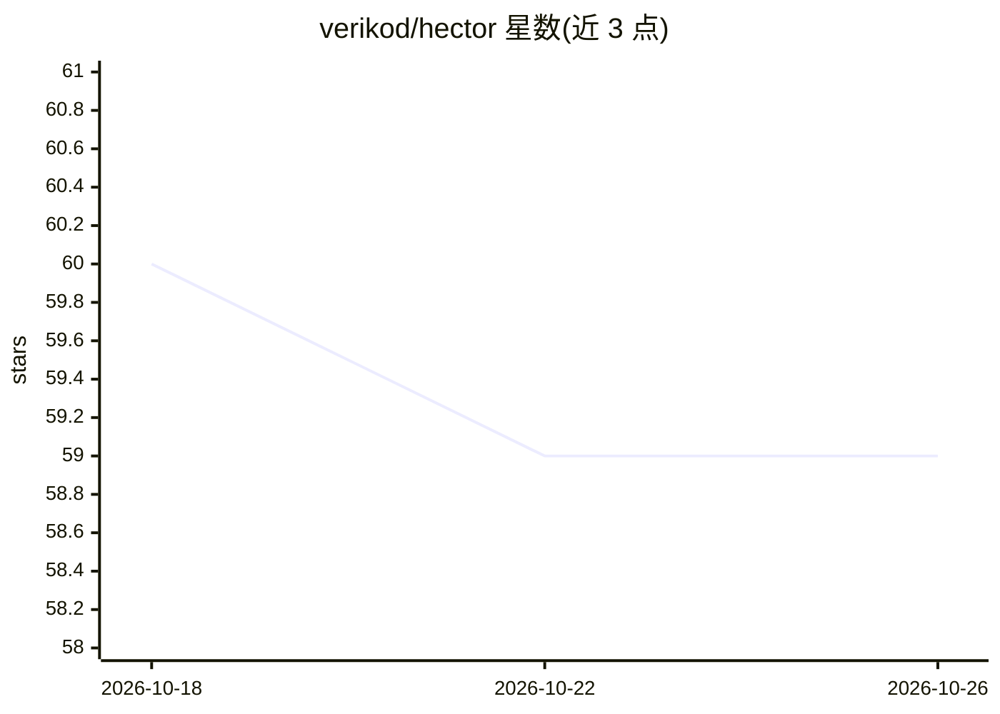

# verikod/hector

⭐ 59 · Go · MIT · 推送 2026-05-18 · [GitHub](https://github.com/verikod/hector) · [官网](https://gohector.dev) · 组织维护

**Go 编写的 A2A 原生 AI agent 运行时平台**

单二进制 AI agent 运行时（约 30MB，内置可视化 Studio UI），以一个 YAML 配置定义 agent、编排模式、RAG 管道、护栏、触发器与通知。基于 A2A 协议做 agent 互操作、MCP 做工具连接，可通过单行配置切换 LLM 提供商（Anthropic/OpenAI/Gemini/Ollama）。会话、任务与检查点持久化到 SQLite 或 PostgreSQL。面向需要完全掌控 AI 基础设施的团队：支持本地部署、气隙环境与多云，提供 JWKS/OIDC 认证、多租户隔离、提示注入检测与 PII 脱敏。MIT 许可，零遥测。

## 筛选速览

| 维度 | 判定 | 备注 |
|---|---|---|
| AI 角色 | `ai-ecosystem` | LLM/agent 周边工具 |
| 许可风险 | `permissive` | MIT |
| 部署形态 | `self-host` | docker 或自建部署 |
| 模型依赖 | local-ok | 支持本地模型 |
| 硬件要求 | — | 无带数字的原话,不猜 |
| 安装摩擦 | `low` | 无编译、无系统依赖或容器化 |
| 成熟度 | — | 结构信号不足 |

## 能力要点

- 单二进制零依赖部署，内置 Studio UI，支持 Linux/macOS/Windows
- YAML 声明式定义 agent、编排、RAG 管道、护栏、定时/Webhook 触发器与出站通知
- A2A 协议 agent 互操作 + MCP 工具连接，LLM 提供商单行配置切换
- SQL 持久化（SQLite/PostgreSQL）、多租户隔离、JWKS/OIDC 认证与 OpenTelemetry 追踪

## 适用场景

- 在企业内网或气隙环境自托管 AI agent 平台，API 密钥不出本机
- 用 YAML 声明多 agent 编排（agent-as-tool、子 agent 委派、条件路由）并纳入 CI 审查
- 接入 MCP 工具与知识库文档，构建带输入输出护栏的 RAG agent
- 通过 Webhook 与定时触发器把 agent 接入现有业务流程

## 场景标签

`Agent 框架` `多智能体` `RAG` · 领域:Agent 开发

## 证据(README 行号)

> L18: Hector is an open-source AI agent runtime built for teams that need full control over their AI infrastructure. One 
> L28: - **Open Standards, Zero Lock-In**: Built entirely on A2A protocol for agent interop and MCP for tool connectivity.

## 星数曲线

2026-10-18 60 → 2026-10-26 59（-1）

---
*卡片 v1 · prompt 1.4 · 生成 2026-10-24 · 置信度 high · 依据 README sha `2c961c5e3c30` · [字段定义](../../DATASET.md)*
