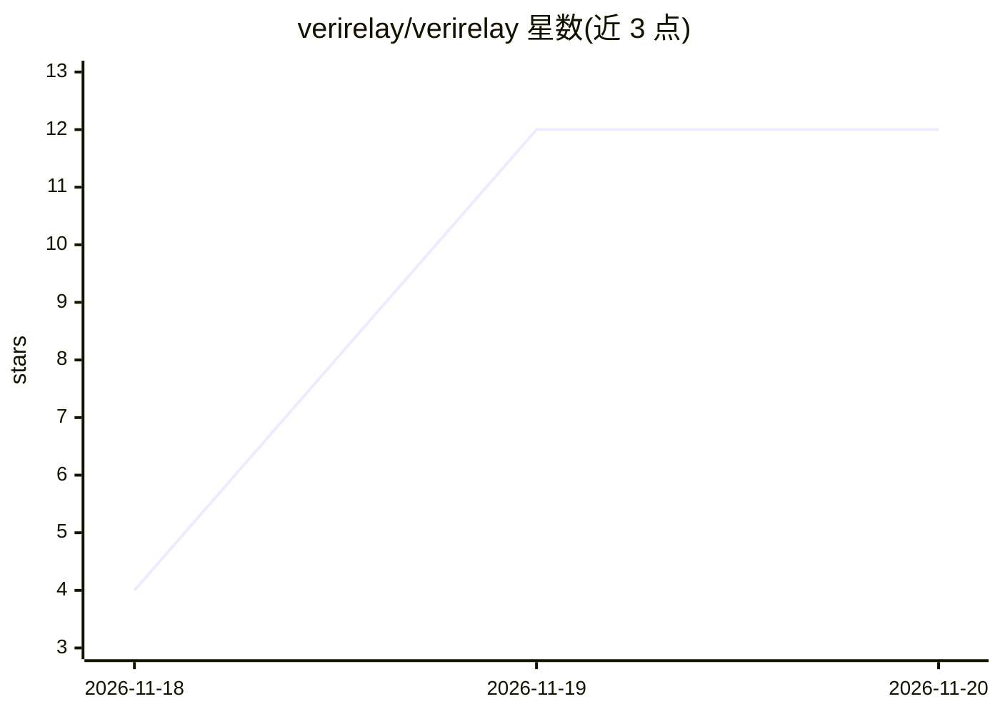

# verirelay/verirelay

⭐ 12 · Go · Apache-2.0 · 推送 2026-11-11 · [GitHub](https://github.com/verirelay/verirelay) · [官网](https://verirelay.com) · 组织维护 · 中文 README

**给 API 转发链路生成可验证回执的透明中继代理**

部署在服务方与其上游 HTTPS API 之间的中继代理：每次转发生成签名 Receipt，记录实际连接的上游域名、TLS 证书密钥及请求/响应体的 SHA-256 哈希（含 SSE 流）。签名密钥仅存在于 AMD SEV-SNP 机密虚拟机内，Attestation Report 绑定可复现构建的源码。客户可用参考 Verifier 或自行实现协议验证。不覆盖 headers、转发前处理及可信时间源。

## 筛选速览

| 维度 | 判定 | 备注 |
|---|---|---|
| AI 角色 | `ai-enhanced` | 去掉 AI 部分产品仍成立 |
| 许可风险 | `permissive` | Apache-2.0 |
| 部署形态 | `None` |  |
| 模型依赖 | — | README 未给出锁定关系 |
| 硬件要求 | — | 无带数字的原话,不猜 |
| 安装摩擦 | `low` | 无编译、无系统依赖或容器化 |
| 成熟度 | — | 结构信号不足 |

## 能力要点

- Receipt 记录上游域名、TLS 证书密钥与请求/响应体 SHA-256 哈希
- 签名密钥仅存于 AMD SEV-SNP 机密 VM，硬件隔离
- 构建可复现，Launch Measurement 可映射到公开源码
- 支持 SSE 流转发，签名在响应发送后完成不增加延迟

## 适用场景

- AI 网关/API 转售商向客户证明请求真实送达上游且响应未被篡改
- Agent 平台向用户证明工具与 API 调用的真实性
- 第三方数据聚合方提供可独立验证的转发凭证
- 链上预言机证明 Web API 数据来源

## 场景标签

`模型网关` · 领域:Agent 开发

## 证据(README 行号)

> L12: VeriRelay lets any service that calls APIs on its customers' behalf prove that it sends each request to the real Up
> L27: - **Unforgeable, even by you**: the Receipt Signing Key exists only inside an AMD SEV-SNP confidential VM, isolated
> L54: - AI model gateways and API resellers;

## 星数曲线

2026-11-18 4 → 2026-11-20 12（+8）

---
*卡片 v1 · prompt 1.4 · 生成 2026-11-19 · 置信度 high · 依据 README sha `ab2914f559ee` · [字段定义](../../DATASET.md)*
