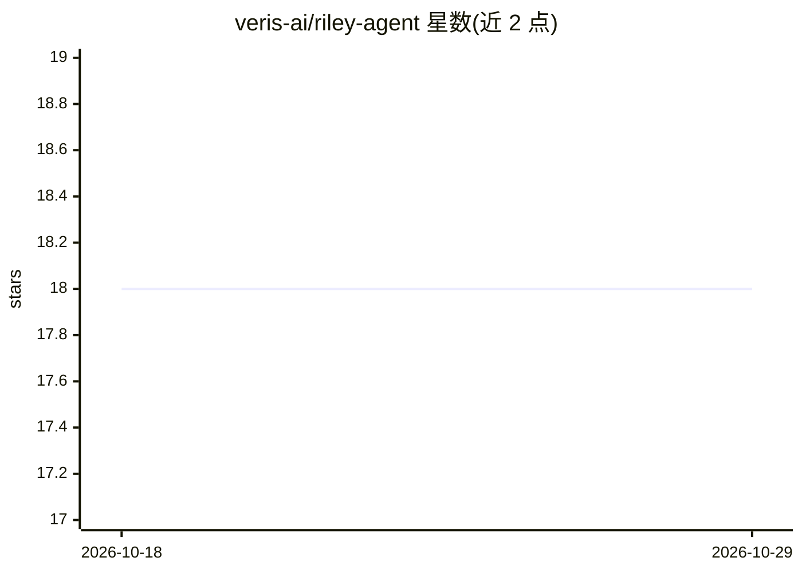

# veris-ai/riley-agent

⭐ 18 · Python · MIT · 推送 2026-09-04 · [GitHub](https://github.com/veris-ai/riley-agent) · [官网](https://veris.ai/leaderboard) · 组织维护

**VAmoS 基准的语音 agent 参考实现集合，跨 17 种语音平台可对比**

面向同一银行卡客服工作流（相同任务、工具与合成 Acme Bank 数据）的语音 agent 实现集合，收录 17 个目录，分别基于不同语音平台或 agent 框架（AssemblyAI、Deepgram、ElevenLabs、Gemini Live、LiveKit、Pipecat、Vapi 等）。每个实现是独立 Python 项目，含平台专属语音运行时、系统提示与工具、合成 Postgres 种子数据、锁定环境与 Veris 仿真配置。供研究者/开发者学习、运行、对比与扩展，接受新增 provider 实现的 PR。数据为合成，作者声明非生产级银行服务。

## 筛选速览

| 维度 | 判定 | 备注 |
|---|---|---|
| AI 角色 | `ai-ecosystem` | LLM/agent 周边工具 |
| 许可风险 | `permissive` | MIT |
| 部署形态 | `None` |  |
| 模型依赖 | local-ok | 支持本地模型 |
| 硬件要求 | — | 无带数字的原话,不猜 |
| 安装摩擦 | `low` | 无编译、无系统依赖或容器化 |
| 成熟度 | — | 结构信号不足 |

## 能力要点

- 17 个实现共用同一任务、工具与合成数据，便于横向对比
- 覆盖 AssemblyAI/Deepgram/ElevenLabs/Gemini Live/LiveKit/Pipecat/Vapi 等平台
- 每个实现自带合成 Postgres schema、种子数据与 Veris 仿真配置
- 各实现独立 Python 项目，含各自 README 与运行说明

## 适用场景

- 对比不同语音平台在同一客服工作流上的表现
- 学习各语音 agent 平台的接入与实现方式
- 为 VAmoS 基准添加新的 provider 实现

## 场景标签

`语音 Agent` `模型评测` · 领域:对话与助手

## 证据(README 行号)

> L3: Riley Agent is a growing collection of voice-agent implementations for the
> L8: The repository is intended to make the implementations easy to study, run,

## 星数曲线

2026-10-18 18 → 2026-10-29 18（+0）

---
*卡片 v1 · prompt 1.4 · 生成 2026-10-29 · 置信度 high · 依据 README sha `d2259414fc48` · [字段定义](../../DATASET.md)*
