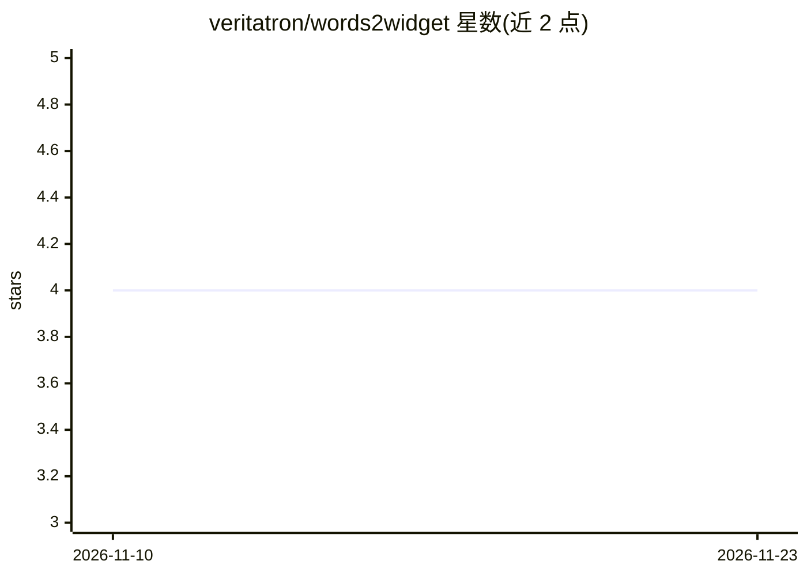

# veritatron/words2widget

⭐ 4 · JavaScript · MIT · 推送 2026-11-09 · [GitHub](https://github.com/veritatron/words2widget) · 个人维护

**用一句话让 AI 生成 iPhone 主屏 Scriptable 小组件**

提供一套提示词（PROMPT.md）与 Claude skill（scriptable-widget.zip），配合 iOS 上的免费 Scriptable 应用和其 Widget Installer 脚本，把用户对小组件内容与样式的自然语言描述转成可直接安装的 Scriptable 代码。小组件可读取日历、提醒事项、位置与天气等本地数据，支持小/中/大三尺寸；仅支持 iPhone 主屏幕，不支持 Android 与锁屏小组件，无需 API key。

## 筛选速览

| 维度 | 判定 | 备注 |
|---|---|---|
| AI 角色 | `ai-native` | 本体是模型或模型工具 |
| 许可风险 | `permissive` | MIT |
| 部署形态 | `desktop` | 安装包/桌面程序 |
| 模型依赖 | locked-api |  |
| 硬件要求 | — | 无带数字的原话,不猜 |
| 安装摩擦 | `low` | 无编译、无系统依赖或容器化 |
| 成熟度 | — | 结构信号不足 |

## 能力要点

- 提供 PROMPT.md 提示词与 Claude skills 两种接入方式
- 配套 Scriptable 的 Widget Installer 一键保存/替换小组件脚本
- 小组件可接入日历、提醒、位置与天气数据
- 无需 API key、无订阅费用

## 适用场景

- 让 AI 生成通勤火车时刻小组件
- 生成每日天气与穿衣建议小组件
- 生成显示日历会议与待办的小组件

## 场景标签

`代码生成` · 领域:编码与开发

## 证据(README 行号)

> L3:  Say what you want on your iPhone home screen. Your AI builds the widget.
> L64:  - **Claude:** Download `scriptable-widget.zip` and upload it in Claude's settings under skills.

## 星数曲线

2026-11-10 4 → 2026-11-23 4（+0）

---
*卡片 v1 · prompt 1.4 · 生成 2026-11-21 · 置信度 high · 依据 README sha `6e6afaa1b6d0` · [字段定义](../../DATASET.md)*
