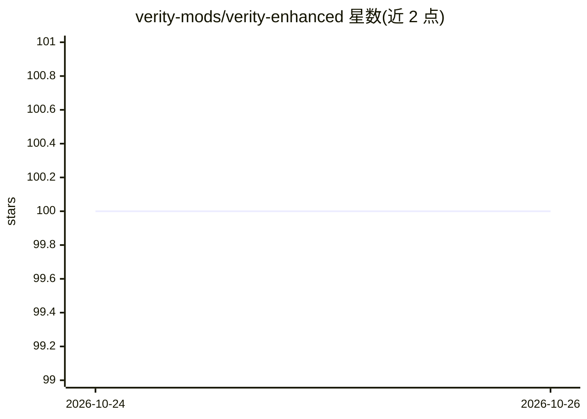

# verity-mods/verity-enhanced

⭐ 100 · MIT · 推送 2026-10-23 · [GitHub](https://github.com/verity-mods/verity-enhanced) · 组织维护

**Minecraft 恐怖模组 Verity 的非官方社区重制版**

粉丝团队对原版 Verity 心理恐怖模组的非官方重制：重写了 Verity 角色的 AI 行为（含耐心机制，角色会记住玩家行为、寻路更激进）、加入新模型与动画、整合删减内容并撰写新剧情，支持达成三种不同结局。兼容 Forge 1.18 至 1.21.11 的各 Minecraft 版本。安装方式为下载 ZIP 压缩包，按游戏版本选取对应 .jar 放入 mods 文件夹，需自备正确版本 Forge。项目声明与原作者及 Mojang 无关，提醒安装前备份存档。

## 筛选速览

| 维度 | 判定 | 备注 |
|---|---|---|
| AI 角色 | `ai-enhanced` | 去掉 AI 部分产品仍成立 |
| 许可风险 | `permissive` | MIT |
| 部署形态 | `desktop` | 安装包/桌面程序 |
| 模型依赖 | — | README 未给出锁定关系 |
| 硬件要求 | — | 无带数字的原话,不猜 |
| 安装摩擦 | `low` | 无编译、无系统依赖或容器化 |
| 成熟度 | — | 结构信号不足 |

## 能力要点

- 重写角色 AI 与耐心机制，角色会记住玩家行为
- 新增剧情与最多三种不同结局
- 重制模型、纹理与动画
- 覆盖 Forge 1.18–1.21.11 的各版本 .jar 文件

## 适用场景

- 在新版本 Minecraft 上游玩 Verity 恐怖模组
- 体验带多结局与扩展剧情的重制版 Verity
- 已装 Forge 的玩家按版本选取 jar 即可安装

## 场景标签

 · 领域:游戏/Minecraft 模组

## 证据(README 行号)

> L44: - 🧠 **Advanced AI & Patience System:** The "patience" mechanic has been completely overhauled. Verity now reacts dy
> L61: No, it's a standard Java modification. Because we use custom AI libraries to improve Verity's behavior, some antivi

## 星数曲线

2026-10-24 100 → 2026-10-26 100（+0）

---
*卡片 v1 · prompt 1.4 · 生成 2026-10-23 · 置信度 high · 依据 README sha `ed1cd707f157` · [字段定义](../../DATASET.md)*
