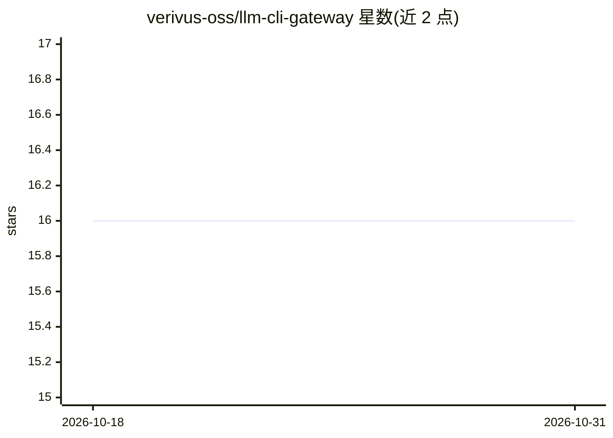

# verivus-oss/llm-cli-gateway

⭐ 16 · TypeScript · MIT · 推送 2026-10-26 · [GitHub](https://github.com/verivus-oss/llm-cli-gateway) · [官网](https://llm-cli-gateway.dev) · 组织维护

**统一操控多家 AI 编码 agent CLI 的单用户 MCP 网关**

面向单用户的 MCP 控制平面：让受支持的 MCP 客户端通过同一网关运行 Claude Code、Codex、Gemini/Antigravity、Grok Build、Mistral Vibe、Devin、Cursor Agent 等 CLI 及配置的 HTTP API 提供方，保留原生 CLI 会话与本地凭据。机制包括持久化异步任务（重启安全、去重、取消）、会话与缓存遥测、git worktree 隔离的多 agent 循环、审批门控、工作区别名限制与跨模型验证回执。限制：不做托管多租户凭据托管，Kit 模式仅支持 Claude/Codex/Mistral。提供 npm 安装、Go 引导安装器、Docker Compose 回退与 Sigstore 签名发布。

## 筛选速览

| 维度 | 判定 | 备注 |
|---|---|---|
| AI 角色 | `ai-ecosystem` | LLM/agent 周边工具 |
| 许可风险 | `permissive` | MIT |
| 部署形态 | `desktop` | 安装包/桌面程序 |
| 模型依赖 | — | README 未给出锁定关系 |
| 硬件要求 | — | 无带数字的原话,不猜 |
| 安装摩擦 | `low` | 无编译、无系统依赖或容器化 |
| 成熟度 | — | 结构信号不足 |

## 能力要点

- 统一同步/异步 MCP 工具运行多家编码 agent CLI 与 HTTP API 提供方
- 持久化异步任务：重启安全结果收集、去重、取消、同步转异步延迟
- 网关管理的 git worktree 隔离多 agent 审查/实现循环
- 9 个内置工作流技能包与跨模型验证工具（validation_receipt 等）

## 适用场景

- 在当前 MCP 客户端内把任务委派给本地多个编码 agent
- 长时任务断线后重启安全地收集结果
- 对高风险操作做审批门控并留存可审计的验证证据

## 场景标签

`多智能体` `模型网关` · 领域:Agent 开发

## 证据(README 行号)

> L14: `llm-cli-gateway` lets supported MCP clients operate Claude Code, Codex, Gemini/Antigravity, Grok Build, Mistral Vi
> L37: `llm-cli-gateway` is a single-user MCP control plane for operating AI coding agents from supported local or remote 
> L39: - Runs registered provider CLIs and configured HTTP API providers through consistent sync and async MCP tools.

## 星数曲线

2026-10-18 16 → 2026-10-31 16（+0）

---
*卡片 v1 · prompt 1.4 · 生成 2026-10-30 · 置信度 mid · 依据 README sha `faf24efb5a28` · [字段定义](../../DATASET.md)*
