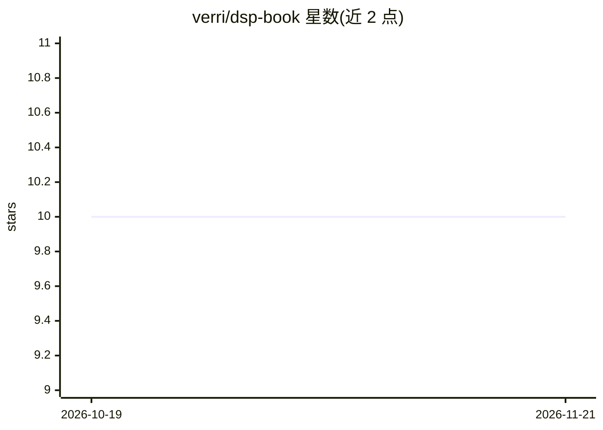

# verri/dsp-book

⭐ 10 · TeX · NOASSERTION · 推送 2026-08-05 · [GitHub](https://github.com/verri/dsp-book) · [官网](https://leanpub.com/dsp) · 组织维护

**数据科学项目方法论的教科书源码仓库**

《Data Science Project: An Inductive Learning Approach》一书的 LaTeX 源码仓库，书籍通过 Leanpub 出版，使用 XeLaTeX 与 make 构建，附 BibTeX 引用条目。内容覆盖数据科学项目开发方法论、软件工程原则、机器学习、数据处理与验证技术。面向有志成为数据科学家的读者、研究人员与从业者。README 另说明作者背景、目录、CC BY-NC 许可与行为准则。

## 筛选速览

| 维度 | 判定 | 备注 |
|---|---|---|
| AI 角色 | `ai-knowledge` | 知识聚合/清单类 |
| 许可风险 | `none` | NOASSERTION |
| 部署形态 | `None` |  |
| 模型依赖 | — | README 未给出锁定关系 |
| 硬件要求 | — | 无带数字的原话,不猜 |
| 安装摩擦 | `low` | 无编译、无系统依赖或容器化 |
| 成熟度 | — | 结构信号不足 |

## 能力要点

- 书籍源码公开，使用 XeLaTeX 构建（make ready）
- 通过 Leanpub 提供书籍下载
- 提供 BibTeX 引用条目（v1.0.0）
- 覆盖机器学习、数据处理与验证技术

## 适用场景

- 作为数据科学项目方法论的学习教材
- 需要引用该书时获取规范 BibTeX 条目
- 从源码自行编译书籍

## 场景标签

`教程课程` · 领域:学习与行业

## 证据(README 行号)

> L5: This repository contains the source of [Data Science Project: An inductive
> L46: This book covers machine learning, data handling, and rigorous validation

## 星数曲线

2026-10-19 10 → 2026-11-21 10（+0）

---
*卡片 v1 · prompt 1.4 · 生成 2026-11-19 · 置信度 high · 依据 README sha `967283400519` · [字段定义](../../DATASET.md)*
