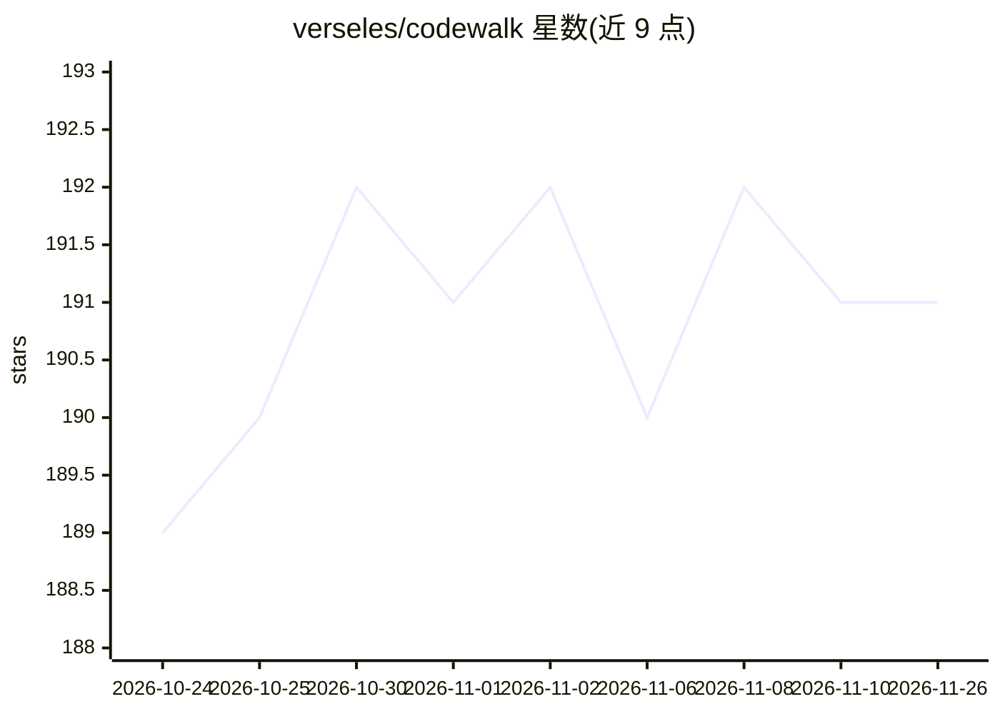

# verseles/codewalk

⭐ 191 · Dart · NOASSERTION · 推送 2026-11-25 · [GitHub](https://github.com/verseles/codewalk) · 个人维护 · 中文 README

**连接 OpenCode 服务器的跨平台原生客户端（移动/桌面）**

CodeWalk 是 OpenCode 服务器的原生跨平台客户端，基于 Flutter/Dart 构建，支持 Android、Linux、Windows 和 macOS（Apple Silicon）。通过 QR 码/配对链接/URL 连接 OpenCode 2 服务器，提供流式 AI 聊天、工具调用与子代理时间线、会话标签与项目侧边栏、多服务器配置文件、语音听写、Markdown/Mermaid/LaTeX 渲染及附件（图片/PDF/音频/位置）支持。安装脚本覆盖桌面端与 Android APK；源码构建需 Flutter SDK 3.47.9 与平台工具链。当前 2.0 处于开放测试阶段。

## 筛选速览

| 维度 | 判定 | 备注 |
|---|---|---|
| AI 角色 | `ai-ecosystem` | LLM/agent 周边工具 |
| 许可风险 | `none` | NOASSERTION |
| 部署形态 | `desktop` | 安装包/桌面程序 |
| 模型依赖 | — | README 未给出锁定关系 |
| 硬件要求 | — | 无带数字的原话,不猜 |
| 安装摩擦 | `medium` | 含编译或系统依赖之一 |
| 成熟度 | `idea` | |

## 能力要点

- 连接 OpenCode 2 服务器的移动/桌面原生客户端（Material 3）
- 子代理与 shell 任务跟踪胶囊，可查看实时输出或停止任务
- QR 码配对与多服务器配置文件切换
- 14 种语言界面，含中文与 RTL 布局支持

## 适用场景

- 在手机或桌面上远程操控 OpenCode 服务器上的 AI 编码会话
- 同时管理多台 OpenCode 服务器并快速切换
- 通过语音听写与附件（图片/PDF/音频）与 AI 助手交互

## 场景标签

`编码 Agent` · 领域:编码与开发

## 证据(README 行号)

> L8: A fast, native cross-platform client for OpenCode servers — built for mobile and desktop.
> L19: - 🧠 **Models, agents & permissions** — switch providers, models, variants, and agents, save favorites, answer permi

## 星数曲线

2026-10-24 189 → 2026-11-26 191（+2）

---
*卡片 v1 · prompt 1.4 · 生成 2026-11-26 · 置信度 high · 依据 README sha `6577cdea93b7` · [字段定义](../../DATASET.md)*
