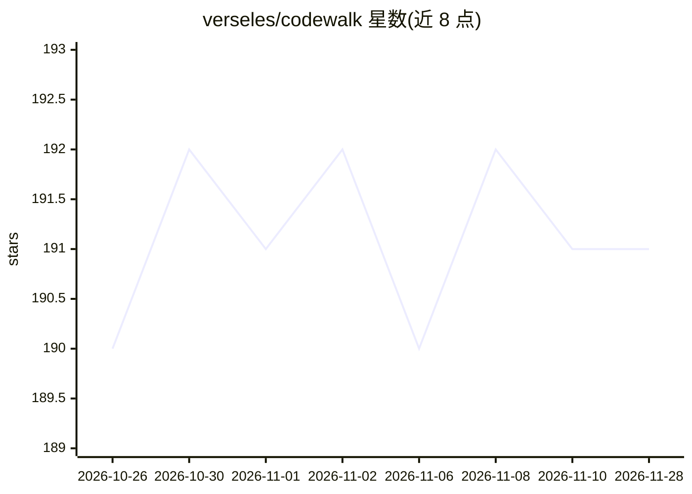

# verseles/codewalk

⭐ 191 · Dart · NOASSERTION · 推送 2026-11-27 · [GitHub](https://github.com/verseles/codewalk) · 个人维护 · 中文 README

**连接 OpenCode 服务器的跨平台原生客户端**

CodeWalk 是 OpenCode 服务器的原生客户端，基于 Flutter/Dart 构建，覆盖 Android、Linux、Windows 与 macOS (Apple Silicon)。提供流式 AI 聊天、工具调用与子代理活动时间线、项目侧栏与会话标签、多服务器配置与 QR 配对、语音听写、14 种语言界面及 Markdown/Mermaid/LaTeX 渲染。通过扫码或手动输入服务器地址连接 OpenCode 2 服务器，v1 用户可经 CODEWALK_CHANNEL=v1 保持旧版。提供安装脚本、APK 及源码构建路径。

## 筛选速览

| 维度 | 判定 | 备注 |
|---|---|---|
| AI 角色 | `ai-ecosystem` | LLM/agent 周边工具 |
| 许可风险 | `none` | NOASSERTION |
| 部署形态 | `desktop` | 安装包/桌面程序 |
| 模型依赖 | — | README 未给出锁定关系 |
| 硬件要求 | — | 无带数字的原话,不猜 |
| 安装摩擦 | `medium` | 含编译或系统依赖之一 |
| 成熟度 | `idea` | |

## 能力要点

- 连接 OpenCode 2 服务器，支持 QR 码与配对链接快速接入
- 流式聊天与工具调用、子代理、shell 命令的实时状态跟踪
- 覆盖 Android/Linux/Windows/macOS 的原生 Material 3 界面，支持 14 种语言
- 内置语音听写（Android/macOS）与消息内 Mermaid/LaTeX/受限 HTML 渲染

## 适用场景

- 在手机或桌面上连接并使用自己的 OpenCode 服务器会话
- 管理多个 OpenCode 服务器配置并快速切换
- 移动场景下通过语音输入与 AI 助手交互

## 场景标签

`AI 助手` · 领域:对话与助手

## 证据(README 行号)

> L8: A fast, native cross-platform client for OpenCode servers — built for mobile and desktop.
> L10: > **CodeWalk 2.0** connects directly to **OpenCode 2** servers on Android, Linux, Windows, and macOS (Apple Silicon
> L90: 2. Keep the harness on OpenCode, then scan your server's QR code or paste a pairing link, or switch to **Manual** a

## 星数曲线

2026-10-26 190 → 2026-11-28 191（+1）

---
*卡片 v1 · prompt 1.4 · 生成 2026-11-28 · 置信度 high · 依据 README sha `dbd26278ef40` · [字段定义](../../DATASET.md)*
