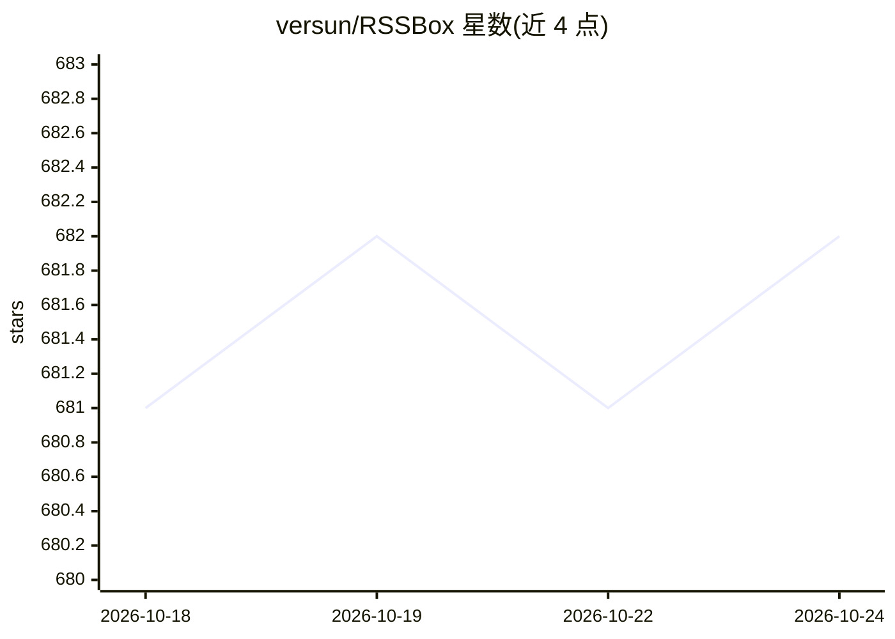

# versun/RSSBox

⭐ 682 · Python · GPL-3.0 · 推送 2026-10-20 · [GitHub](https://github.com/versun/RSSBox) · [官网](https://rssbox.app) · 个人维护 · 中文 README

**自托管的 RSS 翻译、总结与过滤服务**

原名 RSS Translator 的 Django 自托管应用：读取 RSS 源，对标题或内容进行翻译或 AI 总结，支持双语显示，输出翻译后的 RSS/JSON 供订阅。支持 DeepL 及所有 OpenAI 接口兼容模型，每个源可指定翻译引擎并控制更新频率；提供全文获取、关键词过滤、AI 智能过滤、按标签合并多个源，并统计各源 Token/字符消耗。通过 Docker 镜像分发，面向自建信息聚合流程的用户。

## 筛选速览

| 维度 | 判定 | 备注 |
|---|---|---|
| AI 角色 | `ai-enhanced` | 去掉 AI 部分产品仍成立 |
| 许可风险 | `viral` | GPL-3.0 |
| 部署形态 | `self-host` | docker 或自建部署 |
| 模型依赖 | — | README 未给出锁定关系 |
| 硬件要求 | — | 无带数字的原话,不猜 |
| 安装摩擦 | `low` | 无编译、无系统依赖或容器化 |
| 成熟度 | — | 结构信号不足 |

## 能力要点

- 翻译/总结 RSS 标题或内容并双语显示
- 支持 DeepL 与所有 OpenAI 接口兼容模型，每源可指定引擎
- 关键词过滤与 AI 智能过滤、按标签合并多源
- 统计每个源的 Token/字符消耗

## 适用场景

- 订阅外文博客的中文翻译版 RSS
- 用 AI 总结压缩长文源的内容
- 合并并过滤多个 RSS 源为统一输出

## 场景标签

 · 领域:信息聚合/内容处理

## 证据(README 行号)

> L14: 1. 翻译标题或内容或总结
> L21: 10. 关键词过滤和 AI 智能过滤
> L27: - 兼容所有支持 OpenAI 接口的模型

## 星数曲线

2026-10-18 681 → 2026-10-24 682（+1）

---
*卡片 v1 · prompt 1.4 · 生成 2026-10-21 · 置信度 high · 依据 README sha `418ce2a4ab83` · [字段定义](../../DATASET.md)*
