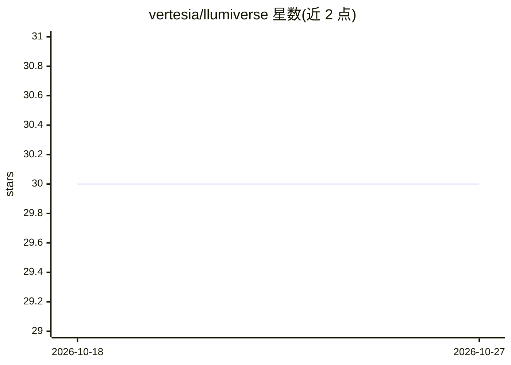

# vertesia/llumiverse

⭐ 30 · TypeScript · 推送 2026-10-26 · [GitHub](https://github.com/vertesia/llumiverse) · 组织维护

**Node.js/Bun 的多 LLM 提供商统一连接驱动库**

面向 Node.js、Bun 与 TypeScript 环境的 LLM 统一驱动层：以模块化、强类型接口抽象各 AI 提供商的连接与执行协议，支持 12 个提供商平台（OpenAI、Bedrock、Vertex AI、Groq 等）的补全、聊天、流式、多模态、工具调用与嵌入生成。采用分包安装（core + drivers），不含提示词模板或链编排逻辑，定位类似 LLM 的 JDBC。要求 Node.js 24.x，Bun 1.0+ 为实验性支持。

## 筛选速览

| 维度 | 判定 | 备注 |
|---|---|---|
| AI 角色 | `ai-ecosystem` | LLM/agent 周边工具 |
| 许可风险 | `none` | — |
| 部署形态 | `library` | 以包/库形式分发 |
| 模型依赖 | locked-api |  |
| 硬件要求 | — | 无带数字的原话,不猜 |
| 安装摩擦 | `low` | 无编译、无系统依赖或容器化 |
| 成熟度 | `idea` | |

## 能力要点

- 12 个提供商平台的统一归一化接口（补全/流式/多模态/工具调用/嵌入）
- 跨提供商归一化工具定义与 JSON Schema 结构化输出
- 分包安装：@llumiverse/core 接口层 + @llumiverse/drivers 实现
- 流式响应标准化为 AsyncIterable

## 适用场景

- 后端服务中切换 LLM 提供商而不改代码
- 构建自定义框架或 CLI 工具时用统一 API 调用多家模型
- 跨提供商复用同一套工具调用与嵌入逻辑

## 场景标签

`模型网关` · 领域:Agent 开发

## 证据(README 行号)

> L7: **Llumiverse** is the unified connectivity layer for the Large Language Model ecosystem. It provides a robust, modul
> L11: It solely focuses on **abstracting the connection and execution protocol**, letting you switch providers with zero 
> L41: These are **application frameworks** that provide high-level abstractions for chains, memory, and RAG. Llumiverse i

## 星数曲线

2026-10-18 30 → 2026-10-27 30（+0）

---
*卡片 v1 · prompt 1.4 · 生成 2026-10-26 · 置信度 high · 依据 README sha `9171eb772828` · [字段定义](../../DATASET.md)*
