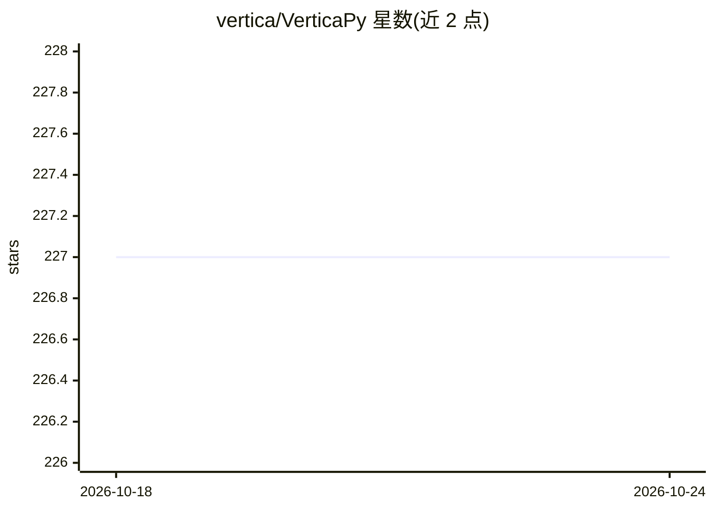

# vertica/VerticaPy

⭐ 227 · Python · Apache-2.0 · 推送 2026-10-08 · [GitHub](https://github.com/vertica/VerticaPy) · [官网](https://www.vertica.com/python/) · 组织维护

**面向 Vertica 数据库的 scikit-learn 风格 Python 数据科学库**

由 Vertica 维护的 Python 库，将数据探索、数据准备、库内机器学习训练与预测、模型评估部署等全流程操作推送到 Vertica 数据库内执行，底层生成 SQL，避免数据搬运。提供 vDataFrame 抽象、pipeline 机制、多种文件读取（AVRO/Parquet/CSV/JSON）、Jupyter SQL Magic 与 DBLINK 多数据库连接，集成 matplotlib/highcharts/plotly 绘图。需连接 Vertica 数据库使用。

## 筛选速览

| 维度 | 判定 | 备注 |
|---|---|---|
| AI 角色 | `ai-native` | 本体是模型或模型工具 |
| 许可风险 | `permissive` | Apache-2.0 |
| 部署形态 | `library` | 以包/库形式分发 |
| 模型依赖 | — | README 未给出锁定关系 |
| 硬件要求 | — | 无带数字的原话,不猜 |
| 安装摩擦 | `low` | 无编译、无系统依赖或容器化 |
| 成熟度 | — | 结构信号不足 |

## 能力要点

- 库内机器学习：训练与预测通过 SQL 在 Vertica 中执行
- vDataFrame 抽象与 pipeline 顺序化数据转换
- Jupyter SQL Magic、SQL 绘图与 DBLINK 跨库查询（聚合下推到数据库）
- 可开启 genSQL/sql_on 查看每条命令底层生成的 SQL

## 适用场景

- 在 Vertica 存储的数据上做探索、清洗与特征工程
- 用 Python/SQL 混合方式训练分类、聚类与时间序列预测模型
- 在 Jupyter 中直接执行 SQL 并生成交互式图表

## 场景标签

 · 领域:数据科学/数据库分析

## 证据(README 行号)

> L21: VerticaPy is a Python library with scikit-like functionality used to conduct data science projects on data stored i
> L289:  ML is the strongest suite of VerticaPy as it capitalizes on the speed of in-database training and prediction by u

## 星数曲线

2026-10-18 227 → 2026-10-24 227（+0）

---
*卡片 v1 · prompt 1.4 · 生成 2026-10-22 · 置信度 high · 依据 README sha `184dcbdce93c` · [字段定义](../../DATASET.md)*
