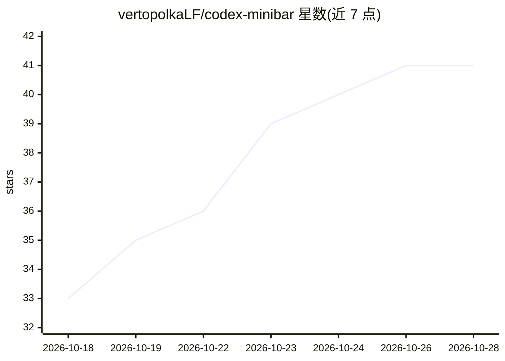

# vertopolkaLF/codex-minibar

⭐ 41 · Rust · Apache-2.0 · 推送 2026-10-27 · [GitHub](https://github.com/vertopolkaLF/codex-minibar) · [官网](https://vertopolkalf.ru/codex-minibar/) · 个人维护 · 中文 README

**Windows 托盘工具：免登录监控 ChatGPT/Codex 等 AI 订阅额度**

用 Rust 编写的原生 Windows 托盘应用，读取本地已认证的 provider 会话，在通知区显示订阅额度、重置倒计时与用量速率，覆盖 Codex、Claude、Cursor、OpenRouter、Grok、Kiro 等十个 provider，支持多账户、任务栏组件、通知、成本/Token 图表（数据本地保存）、九种语言与主题。凭据通过 Windows DPAPI 加密存储，不使用浏览器会话。提供 NSIS 安装器与便携版，无需管理员权限。

## 筛选速览

| 维度 | 判定 | 备注 |
|---|---|---|
| AI 角色 | `ai-ecosystem` | LLM/agent 周边工具 |
| 许可风险 | `permissive` | Apache-2.0 |
| 部署形态 | `desktop` | 安装包/桌面程序 |
| 模型依赖 | locked-api |  |
| 硬件要求 | — | 无带数字的原话,不猜 |
| 安装摩擦 | `low` | 无编译、无系统依赖或容器化 |
| 成熟度 | — | 结构信号不足 |

## 能力要点

- 读取本地已认证会话展示十个 provider 的额度与重置倒计时，无需登录网页
- 多账户管理、任务栏内嵌组件与可配置托盘图标
- 本地扫描历史生成成本/Token 图表，数据全部留在本机
- 凭据以 Windows 用户级 DPAPI 加密存储

## 适用场景

- 在托盘随时查看 Codex/Claude 等 AI 订阅剩余额度与重置时间
- 多账户、多 provider 统一监控用量与花费
- 额度重置或用量告急时收到桌面通知

## 场景标签

 · 领域:AI 工具/桌面监控

## 证据(README 行号)

> L5:  Free, open-source Windows tray companion for AI subscription usage limits with configurable tray widgets, a compact
> L20: Codex Minibar reads quota data from locally authenticated provider sessions and keeps subscription limits and reset

## 星数曲线

2026-10-18 33 → 2026-10-28 41（+8）

---
*卡片 v1 · prompt 1.4 · 生成 2026-10-25 · 置信度 mid · 依据 README sha `74ce65836e49` · [字段定义](../../DATASET.md)*
