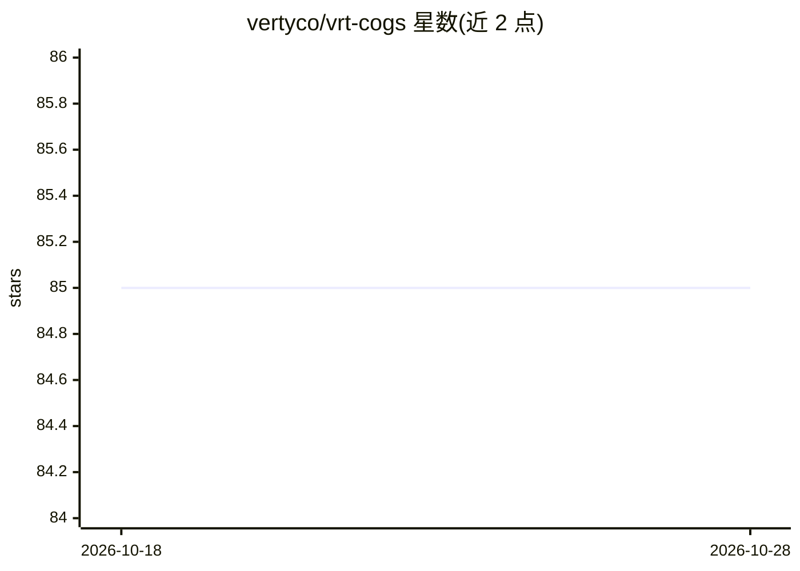

# vertyco/vrt-cogs

⭐ 85 · Python · MIT · 推送 2026-10-25 · [GitHub](https://github.com/vertyco/vrt-cogs) · 个人维护

**面向 Red-DiscordBot 的实用与娱乐插件（cog）合集**

为 Red-DiscordBot（可自托管的 Discord 机器人）提供约 50 个插件（cog），覆盖封禁申诉、银行备份与经济追踪、服务器备份、工单系统、反核防护、Google 表单/Gmail 集成、PalWorld 与 Space Engineers 服务器管理、Xbox 工具，以及 BotArena、MarbleMunch、Sandfall 等在 Discord Activity 中运行的多人游戏。其中 AI 部分：基于 ChatGPT（可自托管）的服务器问答助手 cog，支持 embeddings 与自定义函数扩展；用 OpenAI GPT-Image 模型生成和编辑图片的 ImGen cog。

## 筛选速览

| 维度 | 判定 | 备注 |
|---|---|---|
| AI 角色 | `ai-enhanced` | 去掉 AI 部分产品仍成立 |
| 许可风险 | `permissive` | MIT |
| 部署形态 | `None` |  |
| 模型依赖 | — | README 未给出锁定关系 |
| 硬件要求 | — | 无带数字的原话,不猜 |
| 安装摩擦 | `low` | 无编译、无系统依赖或容器化 |
| 成熟度 | — | 结构信号不足 |

## 能力要点

- Assistant cog：基于 ChatGPT 的服务器问答助手，支持 embeddings 与自定义函数
- ImGen cog：用 OpenAI GPT-Image 模型生成/编辑图片，含按服务器 API key 与冷却控制
- 覆盖经济、工单、反核防护、游戏服务器管理等多类运维与娱乐功能
- ActivityHub：把 Discord Activity 变成游戏菜单，游戏可插拔扩展

## 适用场景

- 给自己的 Red-DiscordBot 添加问答助手、图片生成等 AI 功能
- 搭建封禁申诉、工单、反核防护等服务器管理功能
- 在 Discord Activity 中与好友一起玩内置小游戏
- 从 Discord 远程管理 PalWorld / Space Engineers 服务器

## 场景标签

`聊天机器人` `图像生成` · 领域:对话与助手

## 证据(README 行号)

> L3: Various useful and fun plugins (cogs) for **Red-DiscordBot**, a Discord bot you can run on your own computer!
> L20: |Assistant|Get your own AI assistant in Discord Automate your server with OpenAI's ChatGPT language model (or self-
> L40: |ImGen|Generate and edit images with OpenAI's GPT-Image models. Create images from text prompts, edit existing imag

## 星数曲线

2026-10-18 85 → 2026-10-28 85（+0）

---
*卡片 v1 · prompt 1.4 · 生成 2026-10-24 · 置信度 high · 依据 README sha `825c5f6cf9d5` · [字段定义](../../DATASET.md)*
