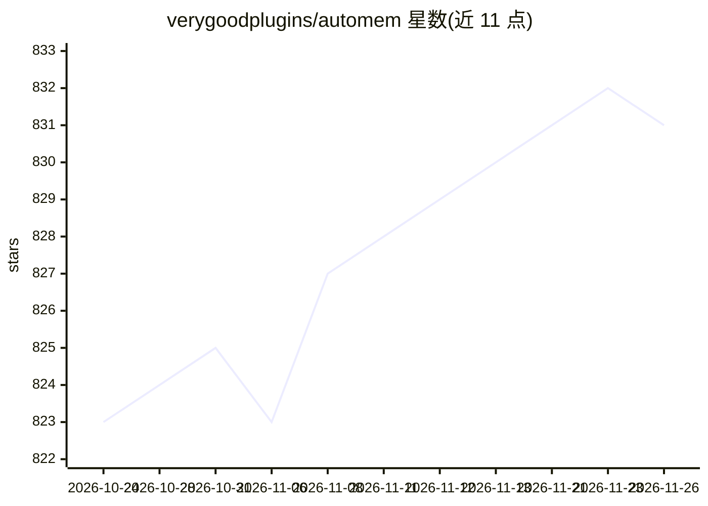

# verygoodplugins/automem

⭐ 831 · Python · MIT · 推送 2026-11-23 · [GitHub](https://github.com/verygoodplugins/automem) · [官网](https://automem.ai/) · 组织维护

**给 AI 助手提供跨会话长期记忆的图+向量存储服务**

AutoMem 以 Flask 服务形式为 AI 助手提供跨会话记忆：FalkorDB 图数据库保存记忆节点与 11 种类型化关系作为权威记录，Qdrant 存储嵌入，召回用十种信号加权混合排序，并提供每日衰减、每周创造性连接、每月聚类的巩固周期。通过 MCP 桥接或 REST API 接入 Claude Desktop、Cursor、ChatGPT 等客户端，可本地 Docker 部署、自有基础设施或 Railway 服务组部署。README 声明其处于 pre-1.0，召回标签过滤、时序更新等尚有限制。

## 筛选速览

| 维度 | 判定 | 备注 |
|---|---|---|
| AI 角色 | `ai-ecosystem` | LLM/agent 周边工具 |
| 许可风险 | `permissive` | MIT |
| 部署形态 | `self-host` | docker 或自建部署 |
| 模型依赖 | — | README 未给出锁定关系 |
| 硬件要求 | — | 无带数字的原话,不猜 |
| 安装摩擦 | `low` | 无编译、无系统依赖或容器化 |
| 成熟度 | `idea` | |

## 能力要点

- 图（FalkorDB，11 种关系类型）+ 向量（Qdrant）双层存储与混合召回
- 召回路径不经生成式 LLM 调用，直接查图与向量索引
- 受神经科学启发的记忆巩固周期（衰减/创造性/聚类/遗忘）
- 本地 MCP 桥与 Remote MCP 同时覆盖桌面与云端助手

## 适用场景

- 让 Claude/Cursor/ChatGPT 记住跨会话的决策与偏好
- 通过多跳桥接发现找回决策背后的理由
- 在自有基础设施或 Railway 上自托管记忆服务

## 场景标签

`Agent 记忆` · 领域:Agent 开发

## 证据(README 行号)

> L26: **One memory across your tools.** Use the local MCP bridge with Claude Desktop, Cursor, Claude Code, Codex, Copilot
> L28: **Own the data and the setup.** Run AutoMem locally with Docker, on your own infrastructure, or as a small Railway 
> L141: |AutoMem API|`http://localhost:8001`|Memory REST API|

## 星数曲线

2026-10-24 823 → 2026-11-26 831（+8）

---
*卡片 v1 · prompt 1.4 · 生成 2026-11-24 · 置信度 mid · 依据 README sha `1e2050af7ad5` · [字段定义](../../DATASET.md)*
