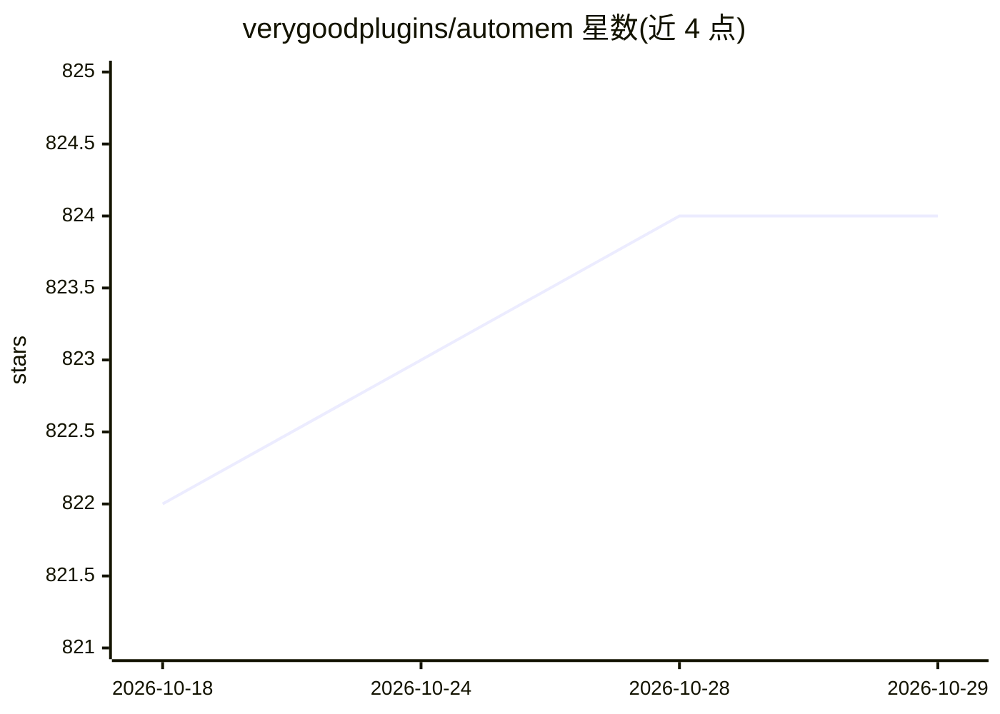

# verygoodplugins/automem

⭐ 824 · Python · MIT · 推送 2026-10-26 · [GitHub](https://github.com/verygoodplugins/automem) · [官网](https://automem.ai/) · 组织维护

**给 AI 助手的长期记忆服务：图谱+向量跨会话召回上下文**

面向 AI 助手（Claude Desktop、Cursor、Codex、ChatGPT 等）的长期记忆服务：以 FalkorDB 图数据库存储带 11 种类型化关系的记忆作为权威记录，Qdrant 存储向量嵌入，召回采用语义相似度+图遍历+时间对齐+重要性等多分量混合评分，召回过程不调用生成式 LLM。支持本地 MCP 桥与 Remote MCP（HTTPS）接入各客户端，也暴露 REST API；可通过 Docker Compose、Railway 或 Python 3.10+ 本地运行。实现 HippoRAG 2、A-MEM 等记忆研究论文的技术。自述 pre-1.0，召回存在标签硬过滤、时间偏好更新等已知限制。

## 筛选速览

| 维度 | 判定 | 备注 |
|---|---|---|
| AI 角色 | `ai-ecosystem` | LLM/agent 周边工具 |
| 许可风险 | `permissive` | MIT |
| 部署形态 | `self-host` | docker 或自建部署 |
| 模型依赖 | — | README 未给出锁定关系 |
| 硬件要求 | — | 无带数字的原话,不猜 |
| 安装摩擦 | `low` | 无编译、无系统依赖或容器化 |
| 成熟度 | — | 结构信号不足 |

## 能力要点

- FalkorDB 图存储 + Qdrant 向量存储的双层架构，11 种可定义关系类型
- 召回过程无 LLM 调用，直接通过图与向量索引检索
- 神经科学启发的记忆巩固循环（Decay/Creative/Cluster/Forget）
- 通过 MCP 桥（本地/Remote）接入 Claude、Cursor、ChatGPT、ElevenLabs 等

## 适用场景

- 让 Claude/Cursor/ChatGPT 等助手跨会话记住决策与偏好
- 追问技术决策的依据与来龙去脉（多跳桥接发现）
- 在自有基础设施上部署私有 AI 记忆服务

## 场景标签

`Agent 记忆` `知识图谱` · 领域:Agent 开发

## 证据(README 行号)

> L30: **Own the data and the setup.** Run AutoMem locally with Docker, on your own infrastructure, or as a small Railway 
> L151: |Claude Desktop, Cursor, Claude Code, Codex, Copilot, Antigravity|Local MCP bridge|`npx @verygoodplugins/mcp-autom

## 星数曲线

2026-10-18 822 → 2026-10-29 824（+2）

---
*卡片 v1 · prompt 1.4 · 生成 2026-10-21 · 置信度 high · 依据 README sha `3602b9b239cf` · [字段定义](../../DATASET.md)*
