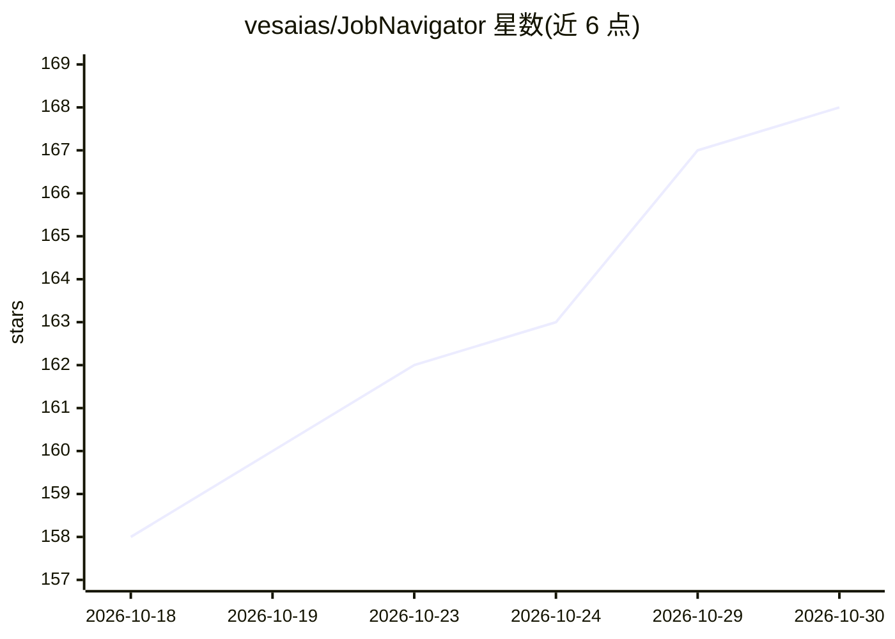

# vesaias/JobNavigator

⭐ 168 · Python · MIT · 推送 2026-10-27 · [GitHub](https://github.com/vesaias/JobNavigator) · [官网](https://vesaias.github.io/JobNavigator-demo) · 个人维护

**自托管求职自动化平台：抓取职位、AI 评分匹配、定制简历、追踪申请**

面向个人或家庭（最多 5 个账户）的自托管求职管理系统：用 Playwright 与 12 个 ATS 处理器、JobSpy、Apify 等抓取招聘页与职位板；调用 LLM（Claude、OpenAI、OpenRouter、Ollama、LM Studio、Claude Code、Codex CLI、Antigravity CLI 或 OpenCode Go）对职位与简历做评分并生成定制简历、求职信；Chrome 扩展实现 LinkedIn 被动捕获与 ATS 表单自动填写；含 Gmail 回复分类、Telegram 告警、申请漏斗统计。通过 Docker Compose 部署，可从 GHCR 拉取预构建镜像或源码构建（linux/amd64 与 arm64）。限制：职位预览 iframe 部分站点会空白，需装扩展；部分爬虫默认关闭且用户自负平台条款。

## 筛选速览

| 维度 | 判定 | 备注 |
|---|---|---|
| AI 角色 | `ai-enhanced` | 去掉 AI 部分产品仍成立 |
| 许可风险 | `permissive` | MIT |
| 部署形态 | `self-host` | docker 或自建部署 |
| 模型依赖 | local-ok | 支持本地模型 |
| 硬件要求 | — | 无带数字的原话,不猜 |
| 安装摩擦 | `low` | 无编译、无系统依赖或容器化 |
| 成熟度 | — | 结构信号不足 |

## 能力要点

- 多数据源职位抓取：Playwright + 12 个 ATS 处理器、JobSpy、Apify、LinkedIn collections 等
- LLM 评分（Light 打分 / Full 报告）与简历、求职信定制，支持 9 种模型接入方式
- Chrome 扩展：LinkedIn 被动捕获、任意页面保存职位、ATS 表单自动填写与自由问答题 AI 作答
- 多账户（1+4）各自独立数据与可选 PIN，共享同一次抓取结果

## 适用场景

- 我汇总各招聘网站的职位并用 AI 按我的简历打分排序
- 我想为每个职位生成定制简历和求职信并跟踪申请进度
- 家庭多人共用一套自部署服务，各自管理求职流程
- 通过 Telegram 接收新职位提醒和 Gmail 回复自动更新状态

## 场景标签

`网页抓取` `浏览器自动化` `AI 写作` · 领域:效率与自动化

## 证据(README 行号)

> L5: **Self-hosted, multi-account job-hunt automation.**
> L7: Scrape career pages and aggregators, score jobs against your résumés with an LLM, tailor résumés and cover letters, 
> L36: |**Scoring**|Claude, OpenAI, OpenRouter, Ollama, LM Studio, Claude Code, Codex CLI, Antigravity CLI or OpenCode Go;

## 星数曲线

2026-10-18 158 → 2026-10-30 168（+10）

---
*卡片 v1 · prompt 1.4 · 生成 2026-10-22 · 置信度 high · 依据 README sha `5dcc290d5ea2` · [字段定义](../../DATASET.md)*
