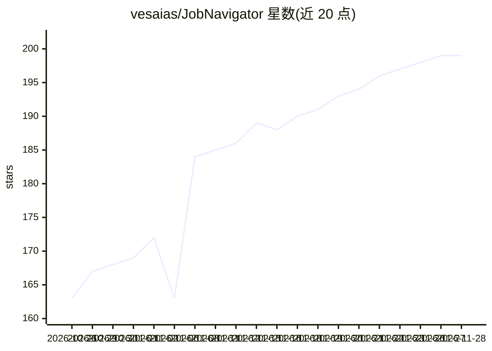

# vesaias/JobNavigator

⭐ 199 · Python · MIT · 推送 2026-11-23 · [GitHub](https://github.com/vesaias/JobNavigator) · [官网](https://vesaias.github.io/JobNavigator-demo) · 个人维护

**自托管多账号求职自动化平台：抓取职位、AI 评分并生成简历**

Docker 部署的自托管求职自动化系统，支持最多五个账号（各含独立职位、简历与设置）。工作流覆盖职位发现（Playwright + 13 种 ATS 处理器、JobSpy、Apify 等多个来源）、LLM 对简历打分与定制、求职信生成、ATS 表单自动填写、申请状态跟踪、Gmail 回复分类与 Telegram 通知。评分模型按功能可分别配置，支持订阅制 CLI 或 API key 接入，方案限额时自动故障转移。Chrome 扩展负责职位捕获与表单填写。

## 筛选速览

| 维度 | 判定 | 备注 |
|---|---|---|
| AI 角色 | `ai-native` | 本体是模型或模型工具 |
| 许可风险 | `permissive` | MIT |
| 部署形态 | `self-host` | docker 或自建部署 |
| 模型依赖 | local-ok | 支持本地模型 |
| 硬件要求 | — | 无带数字的原话,不猜 |
| 安装摩擦 | `low` | 无编译、无系统依赖或容器化 |
| 成熟度 | — | 结构信号不足 |

## 能力要点

- Playwright + 13 种 ATS 处理器及 JobSpy/Apify 等多源职位抓取
- LLM 逐职位评分，每个功能可独立配置模型，支持订阅制 CLI runner
- 简历定制（8 种 PDF 模板与 docx 导出）与求职信生成
- Chrome 扩展实现 ATS 表单自动填写与 LinkedIn 职位捕获

## 适用场景

- 批量抓取职业页面并按我的简历自动打分筛选
- 为每个职位定制简历和求职信后自动填写申请表
- 家庭多人共用一套自托管实例分账号管理求职进度

## 场景标签

`浏览器自动化` `工作流自动化` `网页抓取` · 领域:效率与自动化

## 证据(README 行号)

> L7: Scrape career pages and aggregators, score jobs against your résumés with an LLM, tailor résumés and cover letters, 
> L36: |**Scoring**|Claude, OpenAI, OpenRouter, Ollama, LM Studio, Claude Code, Codex CLI, Antigravity CLI or OpenCode Go;
> L62: docker compose pull && docker compose up -d      # prebuilt images from GHCR

## 星数曲线

2026-10-26 163 → 2026-11-28 199（+36）

---
*卡片 v1 · prompt 1.4 · 生成 2026-11-25 · 置信度 high · 依据 README sha `1cc41f306f46` · [字段定义](../../DATASET.md)*
