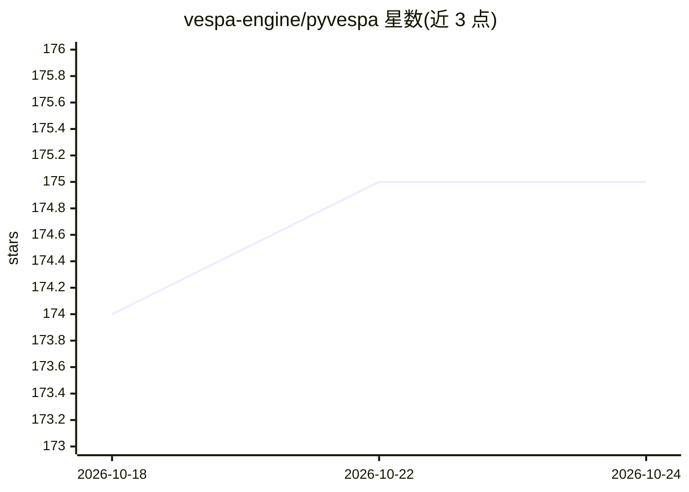

# vespa-engine/pyvespa

⭐ 175 · Python · Apache-2.0 · 推送 2026-10-24 · [GitHub](https://github.com/vespa-engine/pyvespa) · [官网](https://vespa-engine.github.io/pyvespa/) · 组织维护

**Vespa 搜索/服务引擎的 Python API 客户端库**

pyvespa 是开源大数据服务引擎 Vespa 的 Python API 封装，供开发者创建、修改、部署 Vespa 应用并与其运行实例交互。主要目标是加快原型开发并帮助用户熟悉 Vespa 功能。仓库同时包含 Vespa CLI 的 Python 包装器 vespacli。代码以 Apache 2.0 许可发布，通过 PyPI 分发，开发环境用 uv sync --extra dev 安装可编辑版本并强制 Ruff 代码检查。

## 筛选速览

| 维度 | 判定 | 备注 |
|---|---|---|
| AI 角色 | `ai-ecosystem` | LLM/agent 周边工具 |
| 许可风险 | `permissive` | Apache-2.0 |
| 部署形态 | `library` | 以包/库形式分发 |
| 模型依赖 | — | README 未给出锁定关系 |
| 硬件要求 | — | 无带数字的原话,不猜 |
| 安装摩擦 | `low` | 无编译、无系统依赖或容器化 |
| 成熟度 | — | 结构信号不足 |

## 能力要点

- 提供对 Vespa 实例的创建、修改、部署与交互 API
- 附带 Vespa CLI 的 Python 包装器（vespacli）
- 通过 PyPI 发布，支持 uv 管理开发环境

## 适用场景

- 用 Python 快速原型化 Vespa 应用
- 在脚本或 notebook 中管理运行中的 Vespa 实例
- 学习与试验 Vespa 的各项功能

## 场景标签

`语义搜索` `向量数据库` · 领域:知识与检索

## 证据(README 行号)

> L13: Vespa is the scalable open-sourced serving engine that enables users to store,
> L15: `pyvespa` provides a python API to Vespa.
> L16: It allows users to create, modify, deploy and interact with running Vespa instances.

## 星数曲线

2026-10-18 174 → 2026-10-24 175（+1）

---
*卡片 v1 · prompt 1.4 · 生成 2026-10-22 · 置信度 high · 依据 README sha `c3f94e2c2b73` · [字段定义](../../DATASET.md)*
