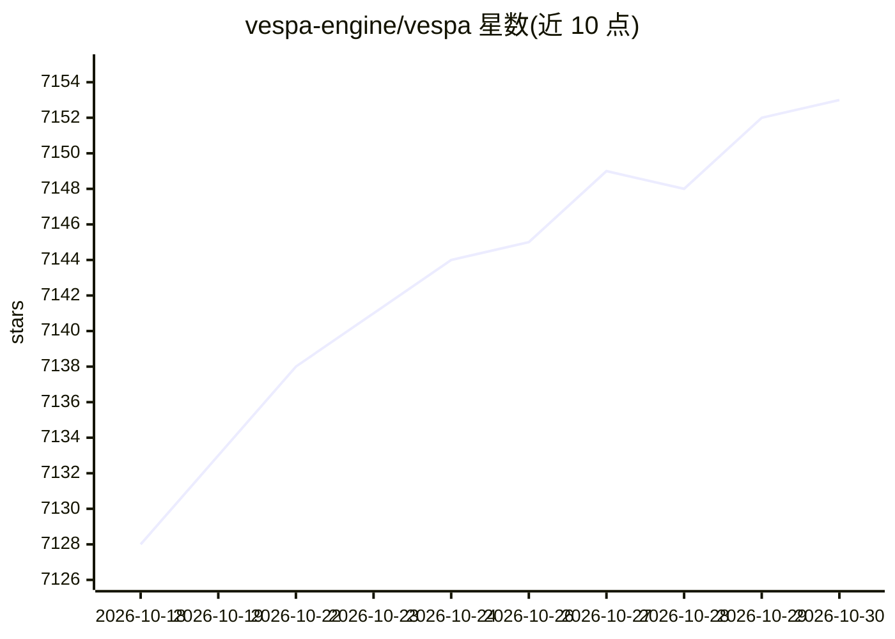

# vespa-engine/vespa

⭐ 7,153 · Java · Apache-2.0 · 推送 2026-10-29 · [GitHub](https://github.com/vespa-engine/vespa) · [官网](https://vespa.ai) · 组织维护

**开源 AI 搜索与数据服务平台：检索、推理、组织向量与结构化数据**

Vespa 是用于搜索、推荐与个性化的服务平台，在服务时对大规模向量、张量、文本与结构化数据执行选择、机器学习模型评估、组织与聚合，要求典型延迟低于 100 毫秒，支持数据分布在多节点并行评估并持续更新。已被多个大型互联网服务用于每秒数十万查询的场景。提供云端部署（console.vespa-cloud.com、免费试用）与自建运行两种途径；仓库含全部源码（Apache 2.0），master 分支每周一至周四早晨发布新版本。README 未给出面向终端使用者的直接安装命令，而是指向 getting-started 文档。

## 筛选速览

| 维度 | 判定 | 备注 |
|---|---|---|
| AI 角色 | `ai-ecosystem` | LLM/agent 周边工具 |
| 许可风险 | `permissive` | Apache-2.0 |
| 部署形态 | `library` | 以包/库形式分发 |
| 模型依赖 | — | README 未给出锁定关系 |
| 硬件要求 | — | 无带数字的原话,不猜 |
| 安装摩擦 | `medium` | 含编译或系统依赖之一 |
| 成熟度 | — | 结构信号不足 |

## 能力要点

- 服务时对向量/张量/文本/结构化数据做检索与模型评估
- 支持多节点分布式数据与并行评估，数据持续变更
- 云端部署与自建实例两种运行方式，免费试用可用
- master 分支每周多次自动发布新版本

## 适用场景

- 构建大规模搜索与推荐服务
- 在生产环境中运行向量检索与模型推理
- 对持续更新的海量数据做实时查询与聚合

## 场景标签

`向量数据库` `语义搜索` `推荐系统` · 领域:知识与检索

## 证据(README 行号)

> L7: Search, make inferences in and organize vectors, tensors, text and structured data, at serving time and any scale.
> L24: Use cases such as search, recommendation and personalization need to select a subset of data in a large corpus,
> L29: parallel. Vespa is a platform that performs these operations for you with high availability and performance.

## 星数曲线

2026-10-18 7,128 → 2026-10-30 7,153（+25）

---
*卡片 v1 · prompt 1.4 · 生成 2026-10-20 · 置信度 mid · 依据 README sha `832c9542ad07` · [字段定义](../../DATASET.md)*
