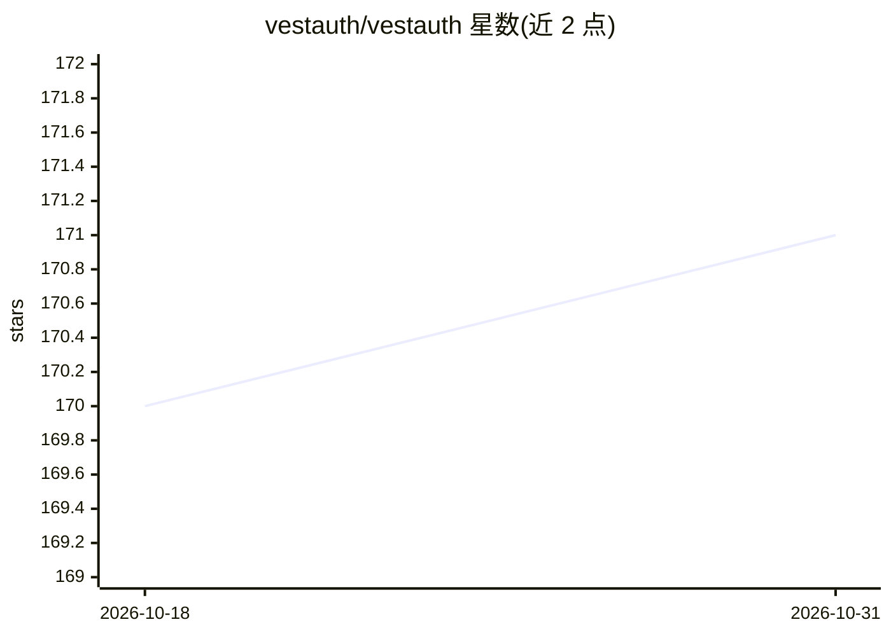

# vestauth/vestauth

⭐ 171 · JavaScript · BSD-3-Clause · 推送 2026-04-16 · [GitHub](https://github.com/vestauth/vestauth) · [官网](https://vestauth.com) · 个人维护

**AI agent 的加密身份与 HTTP 签名认证工具（dotenv 作者）**

由 dotenv/dotenvx 作者开发的 web-bot-auth 实现：为 AI agent 生成 Ed25519 密钥身份（存于 .env），通过 vestauth agent curl 包装器按 web-bot-auth 草案（兼容 RFC 9421）自动签名 HTTP 请求；提供 vestauth.tool.verify 供工具开发者一行代码验证签名，平台侧还处理用量、支付与防滥用。内置第一方工具（文件系统 SFS、邮件 SAM、GEO）与第三方工具目录，支持自托管服务器（需 Postgres、通配符 DNS）。以 npm、curl 脚本、GitHub 二进制与 Windows 可执行文件分发。

## 筛选速览

| 维度 | 判定 | 备注 |
|---|---|---|
| AI 角色 | `ai-ecosystem` | LLM/agent 周边工具 |
| 许可风险 | `permissive` | BSD-3-Clause |
| 部署形态 | `desktop` | 安装包/桌面程序 |
| 模型依赖 | — | README 未给出锁定关系 |
| 硬件要求 | — | 无带数字的原话,不猜 |
| 安装摩擦 | `low` | 无编译、无系统依赖或容器化 |
| 成熟度 | — | 结构信号不足 |

## 能力要点

- 为 agent 生成 Ed25519 身份并自动签名 curl 请求（web-bot-auth 草案、RFC 9421 兼容）
- vestauth.tool.verify 一行代码验证 agent 签名，平台侧处理用量/支付/防滥用
- 第一方工具：SFS 文件系统、SAM 邮件、GEO 定位
- 支持自托管服务器（Postgres、.well-known 发现需通配符 DNS）

## 适用场景

- 给我的 AI agent 一个可验证的加密身份去调用工具 API
- 用签名请求替代 API key 认证 agent 的 HTTP 调用
- 自托管 web-bot-auth 基础设施，控制 agent 认证与密钥轮换

## 场景标签

 · 领域:AI agent 基础设施/认证

## 证据(README 行号)

> L3: *web-bot-auth for agents*–from the creator of `dotenv` and `dotenvx`.
> L193: > Build your own tools. Authenticate them with a single line of code – `vestauth.tool.verify`…

## 星数曲线

2026-10-18 170 → 2026-10-31 171（+1）

---
*卡片 v1 · prompt 1.4 · 生成 2026-10-22 · 置信度 high · 依据 README sha `a41a734e390f` · [字段定义](../../DATASET.md)*
