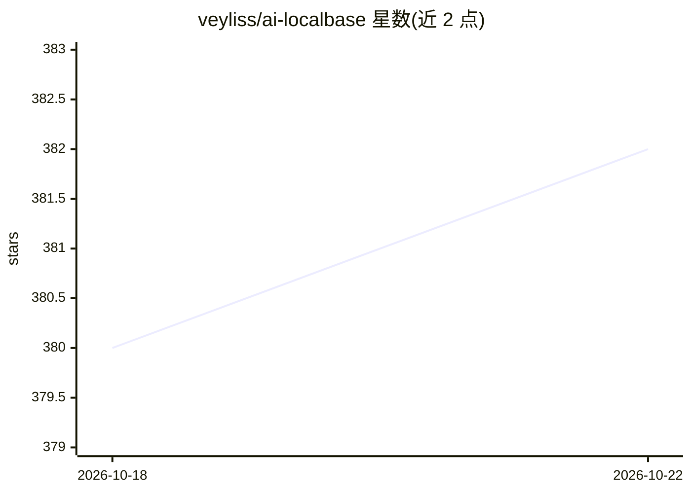

# veyliss/ai-localbase

⭐ 382 · Go · MIT · 推送 2026-09-17 · [GitHub](https://github.com/veyliss/ai-localbase) · 个人维护 · 中文 README

**本地优先的 RAG 知识库问答系统，供个人与小团队自托管**

面向个人或小团队自托管的知识库问答应用：Go+Gin 后端、React 前端、Qdrant 向量库，支持 TXT/Markdown/PDF/xlsx/csv 上传解析、向量检索增强问答、聊天记录 SQLite 持久化。模型接入支持 Ollama 或 OpenAI 兼容接口；检索侧提供混合检索、重排、查询改写、语义缓存等可选项，并可生成 RAG 评估数据集。内置 MCP Server 供外部 Agent 接入。Docker Compose 一键部署；限制：应用层按单实例设计，不支持多后端副本共享写入，默认单文件上传上限 25 MiB。

## 筛选速览

| 维度 | 判定 | 备注 |
|---|---|---|
| AI 角色 | `ai-native` | 本体是模型或模型工具 |
| 许可风险 | `permissive` | MIT |
| 部署形态 | `self-host` | docker 或自建部署 |
| 模型依赖 | local-ok | 支持本地模型 |
| 硬件要求 | — | 无带数字的原话,不猜 |
| 安装摩擦 | `low` | 无编译、无系统依赖或容器化 |
| 成熟度 | — | 结构信号不足 |

## 能力要点

- 本地文档（TXT/MD/PDF/xlsx/csv）上传、解析与向量检索增强问答
- 模型接入支持 Ollama 与 OpenAI 兼容接口（Chat 与 Embedding 分别配置）
- 内置 MCP Server，含工具权限分级、限流与审计，供外部 Agent 调用
- 检索能力含 Hybrid Search、Reranker、Query Rewrite、MMR 与评估数据集生成

## 适用场景

- 把本地个人或团队文档搭建成可问答的知识库
- 自托管环境验证 RAG 检索策略并做小样本评估
- 通过 MCP 让 Cherry Studio / Claude Desktop 等 Agent 调用本地知识库

## 场景标签

 · 领域:LLM 基础设施/RAG 应用

## 证据(README 行号)

> L3: 一个本地优先的 AI 知识库系统（RAG），用于将本地文档接入向量检索与大模型对话流程。项目提供 Web UI，支持知识库管理、文档上传、检索增强问答、聊天记录持久化，以及基于 Ollama 或 OpenAI 兼容接口的模型接入。
> L22: - 检索增强问答：基于 Qdrant 做向量检索并把命中内容注入对话上下文
> L192: 项目内置基础 MCP Server 能力，作为后端内嵌工具服务运行，可供外部 Agent、脚本或工具系统通过 HTTP / JSON-RPC 接入。

## 星数曲线

2026-10-18 380 → 2026-10-22 382（+2）

---
*卡片 v1 · prompt 1.4 · 生成 2026-10-21 · 置信度 high · 依据 README sha `b2d5f5998301` · [字段定义](../../DATASET.md)*
