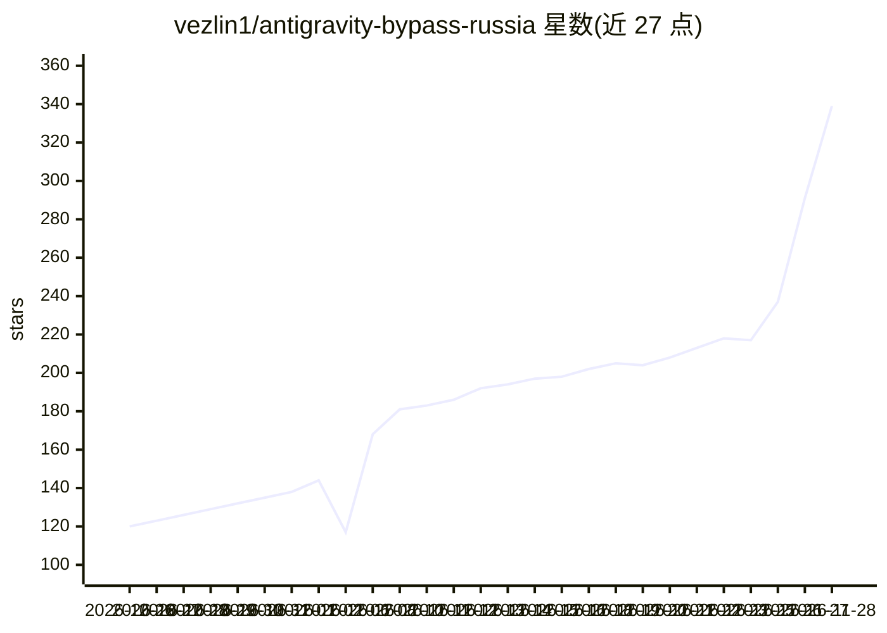

# vezlin1/antigravity-bypass-russia

⭐ 339 · Rust · MIT · 推送 2026-11-27 · [GitHub](https://github.com/vezlin1/antigravity-bypass-russia) · 个人维护

**俄罗斯用户一键解除 Google Antigravity/Gemini 区域限制的工具**

以 Rust 编写的桌面工具，通过本地 DNS 中继（SmartDNS NRPT）与二进制补丁移除 Google Antigravity、Gemini、Antigravity IDE 及 VS Code/Cursor/Windsurf 扩展中的 «User is ineligible» 与 «Location not supported» 区域报错，无需 VPN。交互式菜单提供开启/关闭绕过、单独修文件或网络、指定安装路径、连通性检测、诊断文件导出与回滚还原。Windows 提供 .exe 安装包，macOS 提供安装脚本，Linux 支持 curl 安装脚本、.deb 包、独立二进制与 PKGBUILD。

## 筛选速览

| 维度 | 判定 | 备注 |
|---|---|---|
| AI 角色 | `ai-enhanced` | 去掉 AI 部分产品仍成立 |
| 许可风险 | `permissive` | MIT |
| 部署形态 | `desktop` | 安装包/桌面程序 |
| 模型依赖 | — | README 未给出锁定关系 |
| 硬件要求 | — | 无带数字的原话,不猜 |
| 安装摩擦 | `medium` | 含编译或系统依赖之一 |
| 成熟度 | — | 结构信号不足 |

## 能力要点

- 无需 VPN：仅对 Google AI 服务流量走本地 DNS 中继，其余流量不变
- 本地二进制补丁移除 Antigravity 国家检查
- 一键开启/一键还原（rollback 恢复原始文件与网络设置）
- Windows/macOS/Linux 三平台提供预编译二进制与脚本安装

## 适用场景

- 在俄罗斯家庭/移动网络下直接使用 Google Antigravity 与 Gemini
- Antigravity 更新后重新应用文件补丁
- 排查与 Google AI 服务器的连通性并导出诊断文件

## 场景标签

 · 领域:网络工具/开发工具可用性

## 证据(README 行号)

> L22: Утилита убирает ошибки **«User is ineligible»** и **«Location not supported»** в
> L26: Работает без VPN: всё настраивается одной кнопкой и так же одной кнопкой
> L171: Через локальный DNS-релей идут только запросы к серверам Google AI, а проверка

## 星数曲线

2026-10-26 120 → 2026-11-28 339（+219）

---
*卡片 v1 · prompt 1.4 · 生成 2026-11-26 · 置信度 high · 依据 README sha `18803a54c9a5` · [字段定义](../../DATASET.md)*
