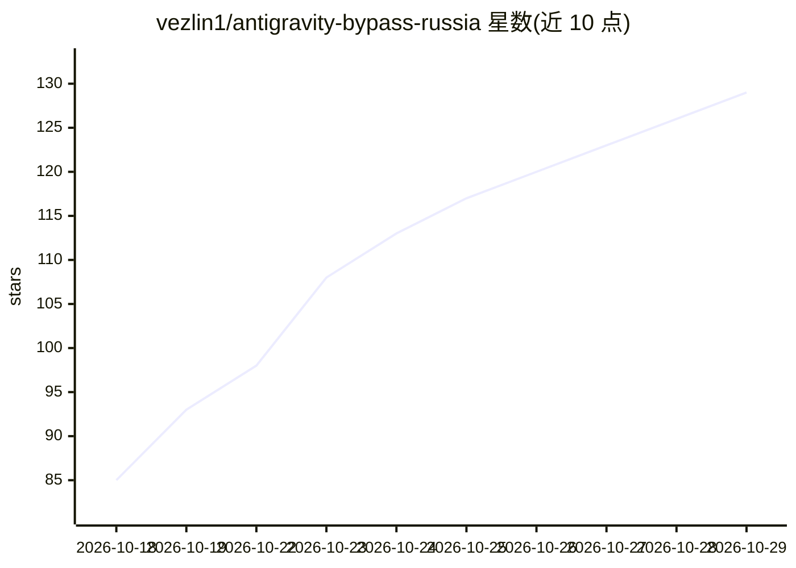

# vezlin1/antigravity-bypass-russia

⭐ 129 · Rust · MIT · 推送 2026-10-25 · [GitHub](https://github.com/vezlin1/antigravity-bypass-russia) · 个人维护 · 中文 README

**在俄罗斯解除 Google Antigravity/Gemini 区域限制的本地工具**

面向俄罗斯用户的免费开源工具，用于消除 Google Antigravity IDE、Gemini 3.x/4.x 及 VS Code/Cursor/Windsurf 扩展中的区域封锁（User is ineligible、Location not supported）。机制为本地操作：通过本地 DNS 中继（Windows NRPT / macOS resolver）对 Google AI 域名做选择性路由，并用 Rust 编写的二进制补丁器移除 Antigravity 内核的国家检查；无需 VPN 或更换 Google 账号区域。提供 Windows/macOS 预构建程序、脚本与源码构建（Rust/Cargo），支持一键完整回滚（.bak 备份恢复）。以 MIT 许可发布，声明仅作研究与教育目的。

## 筛选速览

| 维度 | 判定 | 备注 |
|---|---|---|
| AI 角色 | `ai-ecosystem` | LLM/agent 周边工具 |
| 许可风险 | `permissive` | MIT |
| 部署形态 | `desktop` | 安装包/桌面程序 |
| 模型依赖 | — | README 未给出锁定关系 |
| 硬件要求 | — | 无带数字的原话,不猜 |
| 安装摩擦 | `medium` | 含编译或系统依赖之一 |
| 成熟度 | — | 结构信号不足 |

## 能力要点

- SmartDNS 选择性路由：仅 Google AI 服务域名经本地 DNS 中继，其余流量直连
- Rust 二进制补丁移除 Antigravity 内核区域检查，支持 x64/ARM64
- 覆盖 Antigravity IDE、CLI（agy）及 VS Code/Cursor/Windsurf/VSCodium 扩展
- 一键完整回滚：恢复 .bak 备份、清理 NRPT/resolver 规则与 DNS 缓存

## 适用场景

- 在俄罗斯不经 VPN 直接使用 Google Antigravity IDE 与 Gemini
- 继续使用主 Google 账号而不更换地区
- 解除编辑器更新后重新出现的区域限制提示

## 场景标签

 · 领域:网络/开发工具

## 证据(README 行号)

> L23: **Antigravity Bypass Russia** — бесплатная открытая утилита, которая устраняет региональные блокировки (**`User is 
> L94: Утилита работает точечно и полностью локально на вашем компьютере:

## 星数曲线

2026-10-18 85 → 2026-10-29 129（+44）

---
*卡片 v1 · prompt 1.4 · 生成 2026-10-23 · 置信度 high · 依据 README sha `831d4069a054` · [字段定义](../../DATASET.md)*
