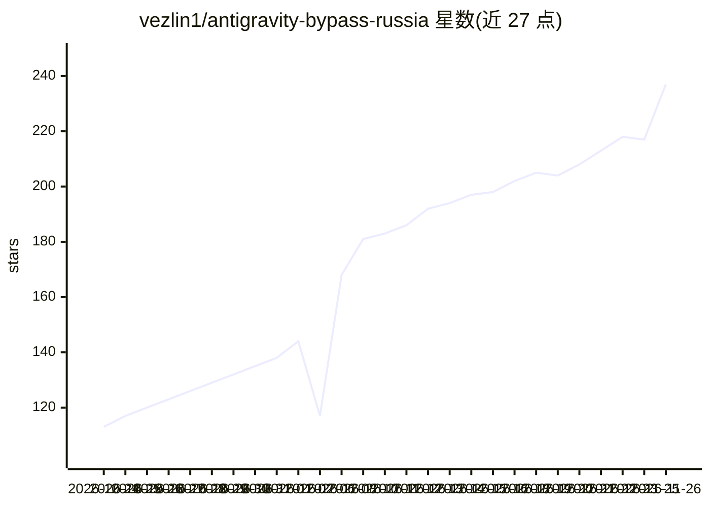

# vezlin1/antigravity-bypass-russia

⭐ 237 · Rust · MIT · 推送 2026-11-25 · [GitHub](https://github.com/vezlin1/antigravity-bypass-russia) · 个人维护

**俄罗斯用户解除 Google Antigravity/Gemini 区域封锁的本地工具**

开源 Rust 工具，通过 SmartDNS 选择性路由、本地 DNS 中继和对 Antigravity 内核的二进制补丁，移除 Google Antigravity、Gemini、Antigravity IDE 及 VS Code/Cursor/Windsurf 扩展中的地区封锁提示（User is ineligible / Location not supported），全程本地运行，仅 Google AI 相关域名走中继，其余流量直连。提供 Windows exe、PowerShell 脚本、macOS shell 脚本、Linux .deb/二进制/源码构建多种分发方式，含诊断与一键回滚。README 注明仅供研究与教育目的，违反服务条款的使用风险由用户自行承担。

## 筛选速览

| 维度 | 判定 | 备注 |
|---|---|---|
| AI 角色 | `ai-enhanced` | 去掉 AI 部分产品仍成立 |
| 许可风险 | `permissive` | MIT |
| 部署形态 | `desktop` | 安装包/桌面程序 |
| 模型依赖 | — | README 未给出锁定关系 |
| 硬件要求 | — | 无带数字的原话,不猜 |
| 安装摩擦 | `medium` | 含编译或系统依赖之一 |
| 成熟度 | — | 结构信号不足 |

## 能力要点

- SmartDNS 选择性路由：仅 Google AI 域名经本地 DNS 中继，其余流量直连
- 对 Antigravity 内核（language_server，x64/ARM64）做二进制补丁移除地区检查
- 一键回滚：从 .bak 备份恢复文件、清除 NRPT/hosts 规则与 DNS 缓存
- 支持 Windows 10/11、macOS（Apple Silicon/Intel）、Linux 多发行版

## 适用场景

- 在俄罗斯本地网络下直接使用 Google Antigravity IDE 与 Gemini
- 替代常开 VPN，保持全部上网速度不被代理拖慢
- 编辑器更新后重新应用解锁并支持完整还原

## 场景标签

 · 领域:网络工具/开发工具

## 证据(README 行号)

> L23: **Antigravity Bypass Russia** — бесплатная открытая утилита, которая устраняет региональные блокировки (**`User is 
> L155: - **Селективная маршрутизация (SmartDNS):**
> L163: ## 🧩 Поддерживаемые редакторы

## 星数曲线

2026-10-24 113 → 2026-11-26 237（+124）

---
*卡片 v1 · prompt 1.4 · 生成 2026-11-25 · 置信度 mid · 依据 README sha `613e318aedde` · [字段定义](../../DATASET.md)*
