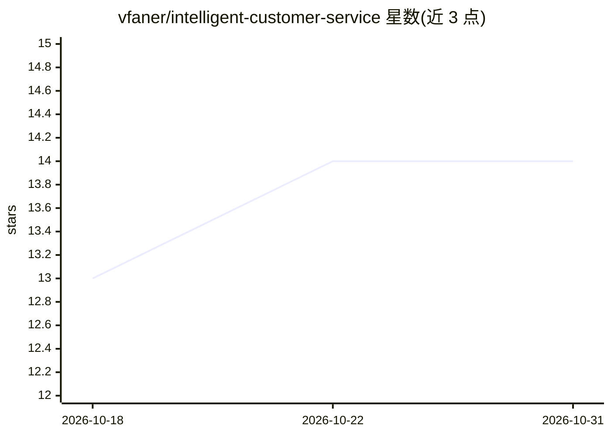

# vfaner/intelligent-customer-service

⭐ 14 · Python · MIT · 推送 2026-10-10 · [GitHub](https://github.com/vfaner/intelligent-customer-service) · [官网](https://kefu.qqmu.com) · 个人维护 · 中文 README

**FastAPI+RAG 多模型智能客服平台，全网页配置**

基于 FastAPI 的自托管智能客服系统：管理后台网页完成全部配置（模型 Key、向量库、RAG 参数、客服信息），无需编辑配置文件或运行初始化脚本。支持 15 项厂商预设（DeepSeek、千问、Claude、Ollama 等），OpenAI/Anthropic 双协议；文档（txt/md/docx/xlsx/pdf）解析后结构感知切分入库 Chroma/Qdrant/Milvus；提供可嵌入网站的零依赖 JS 组件，流式输出，默认严格 RAG 拒答策略。关系库默认 SQLite，支持信创数据库（达梦/金仓等）。后台需登录，单账号设计。

## 筛选速览

| 维度 | 判定 | 备注 |
|---|---|---|
| AI 角色 | `ai-native` | 本体是模型或模型工具 |
| 许可风险 | `permissive` | MIT |
| 部署形态 | `self-host` | docker 或自建部署 |
| 模型依赖 | local-ok | 支持本地模型 |
| 硬件要求 | — | 无带数字的原话,不猜 |
| 安装摩擦 | `low` | 无编译、无系统依赖或容器化 |
| 成熟度 | — | 结构信号不足 |

## 能力要点

- 15 项厂商预设 + OpenAI/Anthropic 双协议适配器
- 文档结构感知切分（章节/Markdown 标题/Q&A 边界）
- Chroma/Qdrant/Milvus 三种向量库可选，含 Milvus Lite 零安装模式
- 换 Embedding 模型一键重建向量库（断点续跑、限流退避）

## 适用场景

- 在网站上嵌入一个基于自有文档的智能客服聊天组件
- 中小企业自托管客服知识库问答系统
- 信创环境（达梦/金仓等）部署客服平台

## 场景标签

`文档问答` `RAG` · 领域:知识与检索

## 证据(README 行号)

> L5: > 基于 **FastAPI + RAG** 的多模型智能客服平台。
> L198: |**📄 文档知识库**|`txt` / `md` / `docx` / `xlsx` / `pdf` 解析 → 结构感知切分 → 向量化 → 入库；MD5 去重；**断点续传**|
> L200: |**🤖 多模型**|15 项厂商配置：DeepSeek、千问/百炼、火山方舟（包月/按量分开）、智谱、Kimi、千帆、OpenAI、Claude、Gemini、Ollama、胜算云、优云智算、2 个自定义|
> L206: |**🪟 可嵌入组件**|单文件 JS（零依赖、免构建），内置 Markdown 渲染 + 链接可点击|

## 星数曲线

2026-10-18 13 → 2026-10-31 14（+1）

---
*卡片 v1 · prompt 1.4 · 生成 2026-10-31 · 置信度 mid · 依据 README sha `fdf8ec75c9d2` · [字段定义](../../DATASET.md)*
