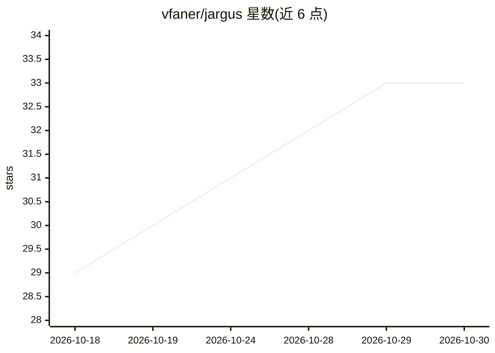

# vfaner/jargus

⭐ 33 · Java · MIT · 推送 2026-10-27 · [GitHub](https://github.com/vfaner/jargus) · [官网](https://jargus.qqmu.com/) · 个人维护 · 中文 README

**面向中小 Java 团队的代码质量评审平台，单 JAR 交付**

基于 Spring Boot 的 Java 代码质量评审平台，以单个 JAR 或 Docker 镜像交付，内嵌 H2 数据库零外部依赖，完全离线可用。提供 19 个本地静态分析检查器（缺陷/安全/架构/并发/风格/依赖 CVE）、五级评分与质量门禁、HTML/PDF 中文报告导出、邮件推送，以及 Webhook 触发的 CI/CD 集成（回写 commit status 与 MR/PR 评论）。AI 深度评审为可选功能，通过 OpenAI 兼容 / Anthropic 双协议接入 12 个厂商模板。另支持 18 类数据库与信创数据库驱动内置。

## 筛选速览

| 维度 | 判定 | 备注 |
|---|---|---|
| AI 角色 | `ai-enhanced` | 去掉 AI 部分产品仍成立 |
| 许可风险 | `permissive` | MIT |
| 部署形态 | `self-host` | docker 或自建部署 |
| 模型依赖 | local-ok | 支持本地模型 |
| 硬件要求 | — | 无带数字的原话,不猜 |
| 安装摩擦 | `low` | 无编译、无系统依赖或容器化 |
| 成熟度 | — | 结构信号不足 |

## 能力要点

- 19 个离线静态分析检查器覆盖六大质量域（含 SQL 注入、SSRF、依赖 CVE）
- 五级评分（BLOCKER–INFO）与质量门禁，扣分与阈值页面可配
- AI 深度评审可选：OpenAI 兼容 / Anthropic 双协议，内置 12 个厂商模板，API Key AES 加密
- Webhook 触发扫描并回写 commit status 与 MR/PR 评论，流水线按门禁阻断合并
- 内嵌 H2 零外部依赖，另支持 MySQL / PostgreSQL / 达梦 / 金仓等 18 类数据库

## 适用场景

- 中小 Java 团队在 CI 流水线中做代码质量门禁与合并阻断
- 内网隔离或信创环境下的代码评审与中文汇报
- 扫描结果自动生成中文 HTML/PDF 报告并邮件推送

## 场景标签

 · 领域:软件开发/代码质量

## 证据(README 行号)

> L10: > 开箱即用的 Java 代码质量评审平台：本地静态分析引擎 + 可选 AI 深度评审 + SonarQube 式五级评分与质量门禁 + CI/CD 全链路联动 + 扫描报告邮件推送。
> L31: - **本地静态分析**：完全离线，19 个检查器覆盖六大质量域——缺陷（空指针 / 资源泄露 / 异常处理）、安全（SQL 注入 / 命令注入 / 反序列化 / 硬编码密钥 / XXE / SSRF 等）、架构分层、并发、风格冗
> L32: - **AI 深度评审（可选）**：OpenAI 兼容 / Anthropic 双协议，内置 12 个厂商模板（百炼 / 方舟 / DeepSeek / Kimi / 智谱 / 千帆 / Gemini / Claude / Oll

## 星数曲线

2026-10-18 29 → 2026-10-30 33（+4）

---
*卡片 v1 · prompt 1.4 · 生成 2026-10-26 · 置信度 high · 依据 README sha `056f312ec465` · [字段定义](../../DATASET.md)*
