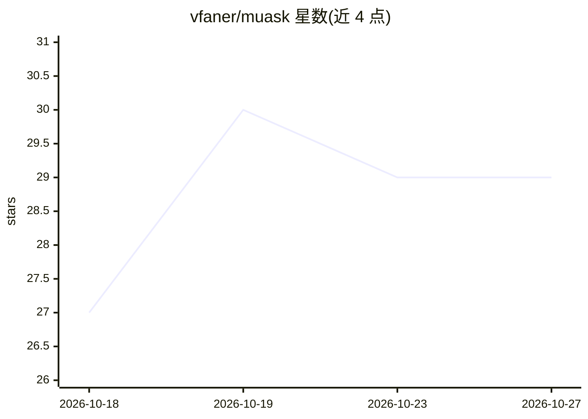

# vfaner/muask

⭐ 29 · Python · MIT · 推送 2026-10-19 · [GitHub](https://github.com/vfaner/muask) · 个人维护 · 中文 README

**桌面 Text2SQL 工具：中文一句话生成并执行 SQL，驱动全内置**

基于 PySide6 的开源桌面 Text2SQL 客户端，面向开发、测试、运维与数据分析人员。选中数据源后自动读取真实表名、字段、主外键与中文注释，用户以中文描述需求，AI 在真实表结构内生成 SQL，经本地预检后可人工核对修改再一键执行，结果分页展示。支持 14 类数据库且驱动随安装包内置（含达梦、金仓、瀚高等信创库），AI 侧提供 OpenAI 兼容与 Anthropic 兼容双协议，可选 Ollama 本地模型。提供 Windows/macOS/Linux 三平台安装包，也可从源码运行。限制：达梦/金仓官方驱动无 macOS wheel；允许所有 SQL 操作，生产环境建议只读账号。

## 筛选速览

| 维度 | 判定 | 备注 |
|---|---|---|
| AI 角色 | `ai-native` | 本体是模型或模型工具 |
| 许可风险 | `permissive` | MIT |
| 部署形态 | `desktop` | 安装包/桌面程序 |
| 模型依赖 | local-ok | 支持本地模型 |
| 硬件要求 | — | 无带数字的原话,不猜 |
| 安装摩擦 | `low` | 无编译、无系统依赖或容器化 |
| 成熟度 | — | 结构信号不足 |

## 能力要点

- 读取真实表结构（表/列/主外键/中文注释）生成 SQL，本地预检后可编辑执行
- 14 类数据库驱动全部内置，含达梦、人大金仓、瀚高、OceanBase、TiDB 等信创库
- OpenAI 兼容与 Anthropic 兼容双协议，支持 Ollama 本地模型免 Key 使用
- 三平台原生打包（exe/DMG/tar.gz），安装包无需 Python 环境

## 适用场景

- 接手无文档的老项目，几百张表快速上手查数
- 临时取数、核对业务口径，不想翻代码手写 SQL
- 信创数据库环境用内置达梦/金仓/瀚高驱动的轻量客户端查数
- 数据隐私敏感场景搭配本地 Ollama，查询不出内网

## 场景标签

`数据分析` · 领域:效率与自动化

## 证据(README 行号)

> L10:  开源免费的桌面 Text2SQL 工具：中文一句话，SQL 自动生成、一键执行。
> L33: **沐问 MuAsk** 就是为这个场景做的。它是一款基于 **PySide6** 的桌面数据库查询工具，把「自然语言 → SQL → 执行」整条链路做成开箱即用的客户端：
> L41: |项目定位|面向开发、测试、运维、数据分析的桌面 Text2SQL 客户端|

## 星数曲线

2026-10-18 27 → 2026-10-27 29（+2）

---
*卡片 v1 · prompt 1.4 · 生成 2026-10-26 · 置信度 mid · 依据 README sha `61097b6c247f` · [字段定义](../../DATASET.md)*
