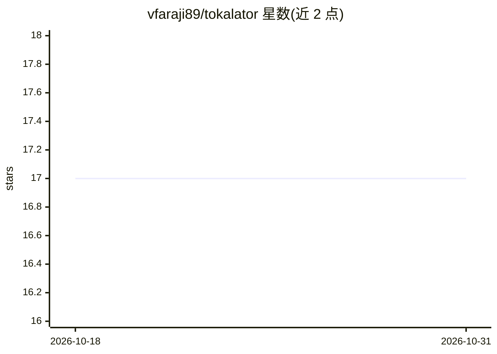

# vfaraji89/tokalator

⭐ 17 · TypeScript · AGPL-3.0 · 推送 2026-10-30 · [GitHub](https://github.com/vfaraji89/tokalator) · [官网](https://tokalator.ai) · 个人维护

**计量 AI 编程工具 token 消耗与成本的 VS Code 扩展及配套**

面向使用 Claude Code、GitHub Copilot 与 Codex 的开发者，提供上下文预算、按 token 与 API 等价成本的用量统计、标签相关性、32 个模型的定价、代码地图与工作区安全功能。仓库含三部分：VS Code 扩展、Claude Code 插件（生成源链接的 GLOSSARY.md 与 SITE-MAP.md）、MCP 服务器与 CLI。扩展经 VS Code Marketplace 安装，MCP 需 npm 构建后注册，AGPL-3.0 且提供商业许可。

## 筛选速览

| 维度 | 判定 | 备注 |
|---|---|---|
| AI 角色 | `ai-ecosystem` | LLM/agent 周边工具 |
| 许可风险 | `dual` | AGPL-3.0 |
| 部署形态 | `library` | 以包/库形式分发 |
| 模型依赖 | locked-api |  |
| 硬件要求 | — | 无带数字的原话,不猜 |
| 安装摩擦 | `low` | 无编译、无系统依赖或容器化 |
| 成熟度 | — | 结构信号不足 |

## 能力要点

- 按 token 与 API 等价成本统计 Claude Code / Copilot / Codex 用量
- 上下文预算、标签相关性与 32 个定价模型
- Claude Code 插件生成源链接的 GLOSSARY.md 与 SITE-MAP.md
- 提供 MCP 服务器与 CLI

## 适用场景

- 查看 AI 编程工具每天花了多少 token 或等价 API 成本
- 为 agent 设定并跟踪上下文预算
- 为 Claude Code 生成代码地图与术语表辅助导航

## 场景标签

 · 领域:开发者工具/AI 编程辅助

## 证据(README 行号)

> L5: Context budget, agent usage for Claude Code, Copilot and Codex, and code maps for your agents.
> L20: |`tokalator-extension-vs/`|The VS Code extension: context budget, Claude Code turns with API-equivalent cost, tab r

## 星数曲线

2026-10-18 17 → 2026-10-31 17（+0）

---
*卡片 v1 · prompt 1.4 · 生成 2026-10-29 · 置信度 high · 依据 README sha `d60d16452201` · [字段定义](../../DATASET.md)*
