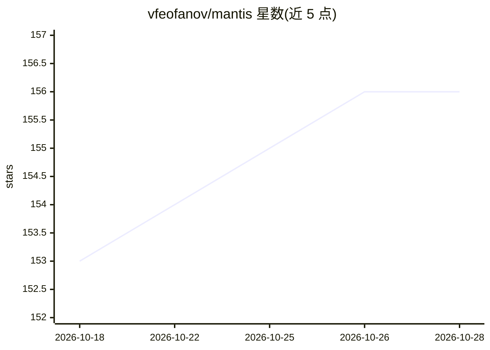

# vfeofanov/mantis

⭐ 158 · Jupyter Notebook · Apache-2.0 · 推送 2026-10-21 · [GitHub](https://github.com/vfeofanov/mantis) · 组织维护

**轻量时间序列分类基础模型库，零样本特征提取与微调**

开源时间序列分类基础模型家族（数百万参数级，可单 GPU 甚至 CPU 微调），提供 2 个骨干与 4 个 Hugging Face checkpoint。核心机制：冻结状态提取深度特征后训练分类器（零样本路径，推荐中间层表示 + 聚合 output token），或用 MantisTrainer 的 fit 方法微调；多通道大数据可用 PCA/可学习适配器降维；支持数据并行预训练（配套开源 CauKer 2M 合成数据集）。输入需为 32 倍数长度的时间序列（预训练长度 512，建议插值）。以 pip 包提供，附 Jupyter 教程。

## 筛选速览

| 维度 | 判定 | 备注 |
|---|---|---|
| AI 角色 | `ai-native` | 本体是模型或模型工具 |
| 许可风险 | `permissive` | Apache-2.0 |
| 部署形态 | `library` | 以包/库形式分发 |
| 模型依赖 | — | README 未给出锁定关系 |
| 硬件要求 | — | 无带数字的原话,不猜 |
| 安装摩擦 | `medium` | 含编译或系统依赖之一 |
| 成熟度 | — | 结构信号不足 |

## 能力要点

- 冻结编码器零样本特征提取 + 微调两种使用方式
- 数百万参数量，单 GPU（甚至 CPU）可微调
- MantisTrainer 提供 scikit-learn 风格 API（transform/fit/predict）
- 多通道适配器（PCA / LinearChannelCombiner）降低内存需求

## 适用场景

- 为我的时间序列数据集零样本提取特征并训练分类器
- 在单张 GPU 上微调时间序列分类模型
- 处理多通道时间序列数据时降低维度与显存占用

## 场景标签

`微调` · 领域:训练与推理

## 证据(README 行号)

> L20: **Mantis** is a family of open-source time series classification foundation models.
> L24:  - *Zero-shot feature extraction:* The model can be used in a frozen state to extract deep features and train a cla

## 星数曲线

2026-10-18 153 → 2026-10-28 156（+3）

---
*卡片 v1 · prompt 1.4 · 生成 2026-10-22 · 置信度 high · 依据 README sha `0d4ca4d21224` · [字段定义](../../DATASET.md)*
