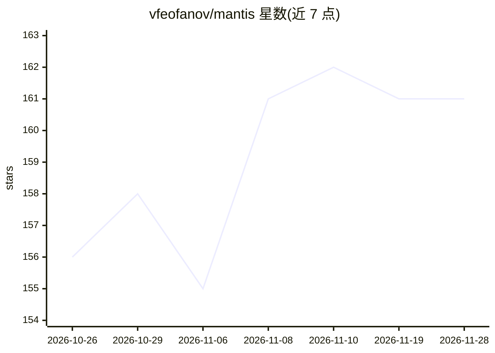

# vfeofanov/mantis

⭐ 161 · Jupyter Notebook · Apache-2.0 · 推送 2026-10-21 · [GitHub](https://github.com/vfeofanov/mantis) · 组织维护

**时间序列分类的轻量基础模型库**

Mantis 是一组开源时间序列分类基础模型（数百万参数规模），提供冻结特征提取、微调与预训练三种使用路径，并给出 scikit-learn 风格的封装 MantisTrainer。输入要求序列长度为 32 的倍数，官方建议插值到 512。针对多通道大数据集提供 PCA 降维或可学习层的适配器；支持 4 GPU torch.distributed 预训练，也可在单 GPU 甚至 CPU 上微调。通过 pip 安装，检查点托管于 Hugging Face，另有多个教程 notebook。

## 筛选速览

| 维度 | 判定 | 备注 |
|---|---|---|
| AI 角色 | `ai-native` | 本体是模型或模型工具 |
| 许可风险 | `permissive` | Apache-2.0 |
| 部署形态 | `library` | 以包/库形式分发 |
| 模型依赖 | — | README 未给出锁定关系 |
| 硬件要求 | — | 无带数字的原话,不猜 |
| 安装摩擦 | `medium` | 含编译或系统依赖之一 |
| 成熟度 | — | 结构信号不足 |

## 能力要点

- 冻结特征提取 + 任意分类器训练的零样本路径
- scikit-learn 风格封装（transform/fit/predict）
- 多通道适配器：PCA 降维与可学习层两种方案
- 支持 torch.distributed 多 GPU 预训练与 HF 数据集输入

## 适用场景

- 对时间序列做零样本特征提取后训练分类器
- 在单 GPU 上微调小型基础模型完成分类任务
- 多通道大规模数据集上降维后训练
- 基于合成数据集 CauKer 2M 自行预训练模型

## 场景标签

`微调` `模型训练` · 领域:训练与推理

## 证据(README 行号)

> L20: **Mantis** is a family of open-source time series classification foundation models.
> L24:  - *Zero-shot feature extraction:* The model can be used in a frozen state to extract deep features and train a cla
> L162: y_pred = model.predict(X)

## 星数曲线

2026-10-26 156 → 2026-11-28 161（+5）

---
*卡片 v1 · prompt 1.4 · 生成 2026-11-27 · 置信度 high · 依据 README sha `d895032329b1` · [字段定义](../../DATASET.md)*
