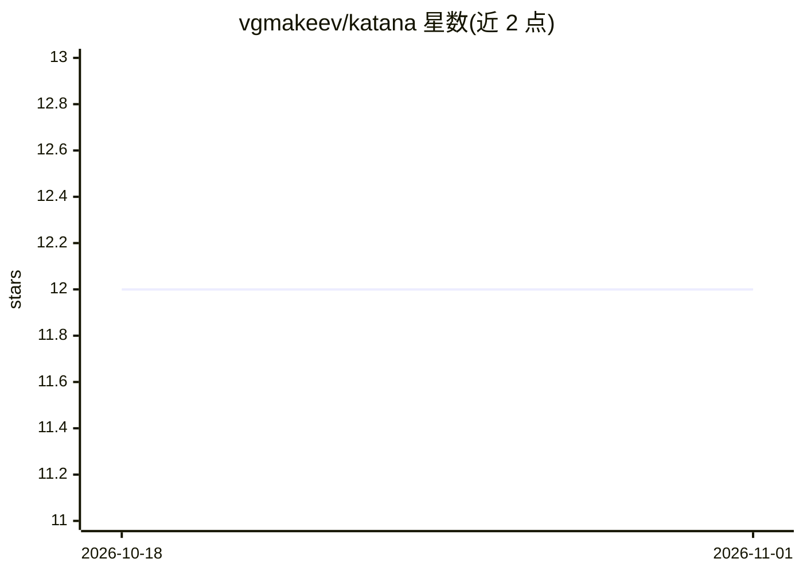

# vgmakeev/katana

⭐ 12 · Python · Apache-2.0 · 推送 2026-10-29 · [GitHub](https://github.com/vgmakeev/katana) · 个人维护

**给 AI 编程 agent 的确定性重构工具：源码结构图+按计划拆分大文件**

面向 AI 编程 agent 的多语言重构基础设施：将大文件转为不含源码正文的架构图（LOC、签名、字节级 span、约束），由 agent 制定拆分计划后，Katana 按字节精确移动源码区间并调用项目自带的格式化/静态检查工具验证。支持 Python/Rust/TS/Dart/CSS/Markdown 等栈，提供非交互 JSON 协议与 dry-run。当前限制：仅做单文件架构拆分，不做项目级 import 重写。通过 uvx 从 GitHub 运行或 uv tool install 安装。

## 筛选速览

| 维度 | 判定 | 备注 |
|---|---|---|
| AI 角色 | `ai-ecosystem` | LLM/agent 周边工具 |
| 许可风险 | `permissive` | Apache-2.0 |
| 部署形态 | `library` | 以包/库形式分发 |
| 模型依赖 | — | README 未给出锁定关系 |
| 硬件要求 | — | 无带数字的原话,不猜 |
| 安装摩擦 | `low` | 无编译、无系统依赖或容器化 |
| 成熟度 | — | 结构信号不足 |

## 能力要点

- 生成不含源码正文的 DocumentIR 架构图（签名、字节级 span、约束）
- 源码区间按字节精确移动，不依赖 LLM 复现代码
- apply --check dry-run 不写工作树，调用项目自带 Ruff/ESLint/tsc 等验证
- 支持 Python/Rust/TypeScript/Dart/CSS/Markdown，可通过适配器扩展其他语言

## 适用场景

- AI agent 在不加载整个大文件的情况下重构长文件
- 控制代码库中单文件行数超标（500 行门槛）
- 拆分过长的 Markdown 文档以节省 agent 上下文

## 场景标签

 · 领域:开发工具/代码智能

## 证据(README 行号)

> L5: Deterministic, polyglot refactoring infrastructure for coding agents.
> L12: Katana lets an AI agent redesign a large file without loading the whole file
> L14: explicit split plan, moves the selected source ranges byte-for-byte, and then

## 星数曲线

2026-10-18 12 → 2026-11-01 12（+0）

---
*卡片 v1 · prompt 1.4 · 生成 2026-10-31 · 置信度 mid · 依据 README sha `61cfe48b65db` · [字段定义](../../DATASET.md)*
