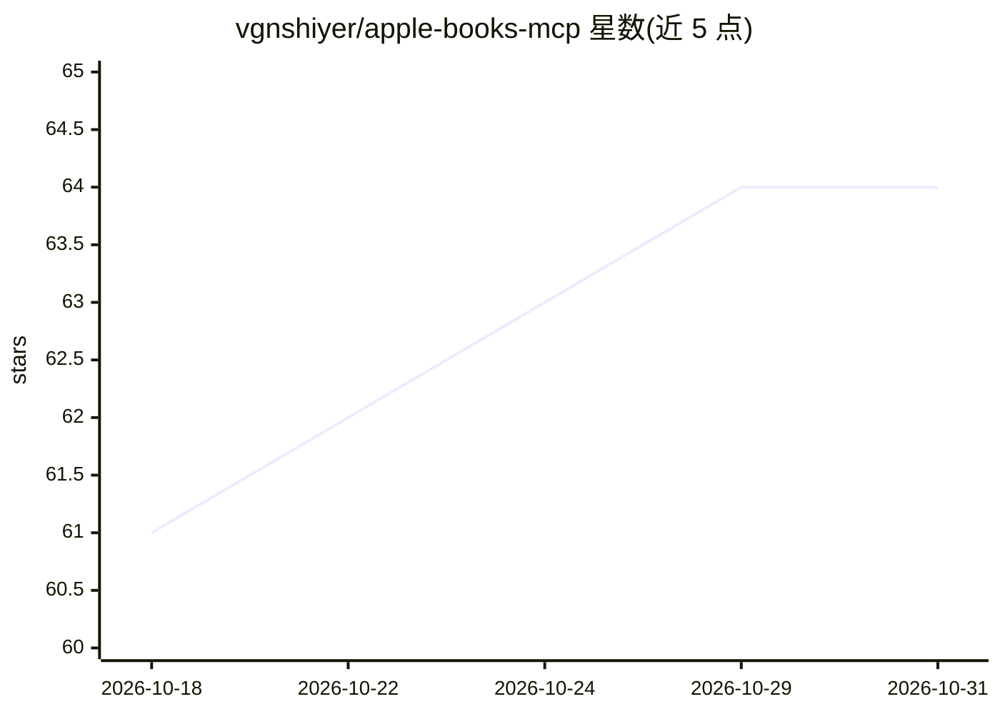

# vgnshiyer/apple-books-mcp

⭐ 64 · Python · Apache-2.0 · 推送 2026-10-16 · [GitHub](https://github.com/vgnshiyer/apple-books-mcp) · [官网](https://vgnshiyer.me/AppleBooksMcp) · 个人维护

**让 Claude 读取 Apple Books 书库、划线与章节内容的 MCP 服务器**

面向 macOS Apple Books 的 MCP 服务器，提供 40 余个工具供 Claude Desktop / Claude Code 调用：列出/搜索书库与分类、读取标注（划线、笔记）及其上下文、读取非 DRM EPUB 的章节纯文本（含当前阅读位置）、按主题聚类划线、生成每周阅读摘要等。集合编辑默认关闭，需 --enable-writes 显式开启，写入前自动备份且 Books 打开时拒绝执行。文本内容包在 <book_text> 标签中并声明为不可信数据。依赖 macOS 与 Apple Books 本地库。

## 筛选速览

| 维度 | 判定 | 备注 |
|---|---|---|
| AI 角色 | `ai-ecosystem` | LLM/agent 周边工具 |
| 许可风险 | `permissive` | Apache-2.0 |
| 部署形态 | `self-host` | docker 或自建部署 |
| 模型依赖 | — | README 未给出锁定关系 |
| 硬件要求 | — | 无带数字的原话,不猜 |
| 安装摩擦 | `low` | 无编译、无系统依赖或容器化 |
| 成熟度 | — | 结构信号不足 |

## 能力要点

- 按标题/作者模糊搜索书库，忽略大小写、重音与引号样式
- 读取非 DRM EPUB 章节文本与当前阅读位置（CFI 自动书签）
- 划线上下文提取、按颜色/日期/关键词检索标注
- 集合编辑为可选功能：写入前 WAL 安全备份、Books 运行时拒绝写

## 适用场景

- 让 Claude 追踪我正在读的书并就当前章节讨论
- 汇总一段时间内的高亮与笔记，生成阅读摘要
- 跨书籍分析高亮中的主题与反复出现的想法

## 场景标签

`文档问答` · 领域:知识与检索

## 证据(README 行号)

> L3: Model Context Protocol (MCP) server for Apple Books.
> L14: * **Pick up where you left off** — Claude sees the book you're reading, your progress and the chapter you're on, an

## 星数曲线

2026-10-18 61 → 2026-10-31 64（+3）

---
*卡片 v1 · prompt 1.4 · 生成 2026-10-24 · 置信度 mid · 依据 README sha `769d5b14ac6c` · [字段定义](../../DATASET.md)*
