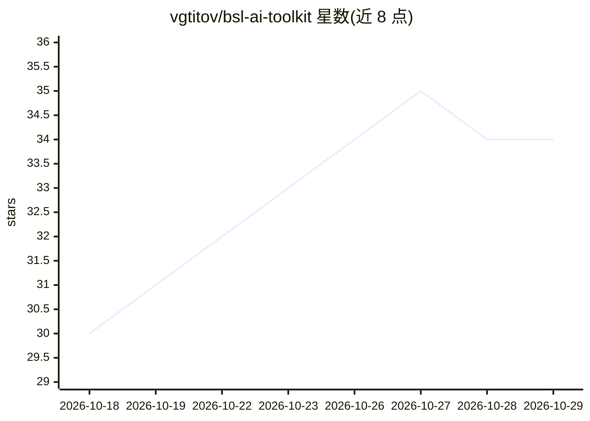

# vgtitov/bsl-ai-toolkit

⭐ 34 · Python · MIT · 推送 2026-10-28 · [GitHub](https://github.com/vgtitov/bsl-ai-toolkit) · 个人维护

**给 1C:Enterprise (BSL) 开发者的 AI agent 工具集：规则/技能/MCP 服务器**

面向 1С:Предприятие 8.3 (BSL) 开发的 AI agent 工具包，由规则（AGENTS.md）、技能（SKILL.md）与 MCP 服务器组成：onec-code 按真实配置代码检索、bsl-ls 在每次修改后跑 BSL Language Server 诊断、onec_metadata 以确定性引擎做 byte-perfect 元数据修改并在测试库做 round-trip 验证、onec-ops 处理运维与性能、onec-data 以只读方式访问生产库数据。参考实现为 Claude Code，Cursor/Copilot/Gemini CLI 等经适配器接入；文档为俄语，需 Python 3.11+，支持 macOS/Linux/Windows。

## 筛选速览

| 维度 | 判定 | 备注 |
|---|---|---|
| AI 角色 | `ai-ecosystem` | LLM/agent 周边工具 |
| 许可风险 | `permissive` | MIT |
| 部署形态 | `None` |  |
| 模型依赖 | — | README 未给出锁定关系 |
| 硬件要求 | — | 无带数字的原话,不猜 |
| 安装摩擦 | `medium` | 含编译或系统依赖之一 |
| 成熟度 | — | 结构信号不足 |

## 能力要点

- 5 个 MCP 工具：代码检索、BSL 诊断、byte-perfect 元数据修改、运维、只读数据访问
- 元数据修改经测试库 round-trip 验证（加载+重导出=目标 diff）
- agent 无关架构：Claude Code 为参考实现，其余 agent 经 adapters/ 接入
- 内置 Jira/Confluence/Zabbix/Prometheus/技术日志集成

## 适用场景

- 让 AI agent 基于我的 1C 真实代码而非记忆来写 BSL 代码
- 自动且可验证地修改 1C 元数据（表单/СКД/属性）
- 让 agent 参与生产库运维分析（APDEX、技术日志、锁等待）

## 场景标签

`编码 Agent` · 领域:编码与开发

## 证据(README 行号)

> L9: Набор **правил, скиллов и MCP-серверов** для разработки на **1С:Предприятие 8.3 (BSL)** с ИИ-агентом. Агент ищет по
> L50: - **`onec-code`** — поиск по реальному коду конфигурации и расширения (оба слоя контура), а не по памяти;
> L122: Toolkit **agent-agnostic и provider-agnostic**. Основные агенты — **Claude Code** (Sonnet 4.5 — лучший по BSL) и *

## 星数曲线

2026-10-18 30 → 2026-10-29 34（+4）

---
*卡片 v1 · prompt 1.4 · 生成 2026-10-25 · 置信度 high · 依据 README sha `7a22e5486ee7` · [字段定义](../../DATASET.md)*
