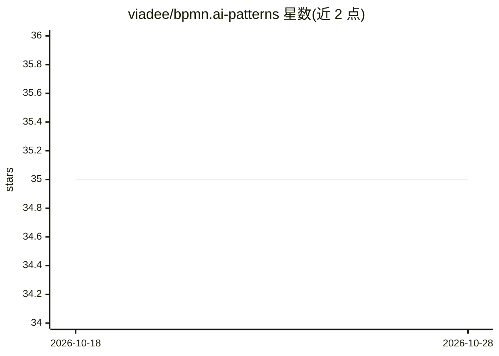

# viadee/bpmn.ai-patterns

⭐ 35 · BSD-3-Clause · 推送 2026-09-28 · [GitHub](https://github.com/viadee/bpmn.ai-patterns) · 组织维护

**在 BPMN 业务流程中编排 AI 服务的集成模式目录**

由 viadee 咨询团队（Ben Wolters、Frank Köhne、Mario Micudaj）维护的模式集合：以小型 BPMN 流程图形式描述将机器学习/AI 决策集成到业务流程中的做法，分组覆盖入门（流程数据收集、DMN 替代 AI 运行时、结果异常检测）与可干预性（可控自动化程度、AI 优先决策支持）等。面向已使用工作流引擎（如 Camunda）的组织，用作数据科学家与流程负责人之间的沟通工具和落地检查清单。仓库为文档型内容，不含可安装代码。

## 筛选速览

| 维度 | 判定 | 备注 |
|---|---|---|
| AI 角色 | `ai-knowledge` | 知识聚合/清单类 |
| 许可风险 | `permissive` | BSD-3-Clause |
| 部署形态 | `None` |  |
| 模型依赖 | — | README 未给出锁定关系 |
| 硬件要求 | — | 无带数字的原话,不猜 |
| 安装摩擦 | `low` | 无编译、无系统依赖或容器化 |
| 成熟度 | — | 结构信号不足 |

## 能力要点

- 以 BPMN 小流程图形式描述 AI 集成模式
- 模式按入门与可干预性等分组组织
- 作为数据科学家与流程负责人之间的沟通工具与检查清单

## 适用场景

- 将 AI 决策以可控方式集成到已有工作流引擎的业务流程
- 在 AI 项目从 PoC 走向生产时作为模式检查清单
- 通过置信度阈值等方式控制 AI 自动化程度

## 场景标签

`工作流自动化` `精选清单` · 领域:效率与自动化

## 证据(README 行号)

> L10: In our projects, we found the following list of patterns useful. On the one hand, they serve as a means of communic
> L11: The patterns can be easily understood as small BPMN processes. They serve different purposes, but most of them help

## 星数曲线

2026-10-18 35 → 2026-10-28 35（+0）

---
*卡片 v1 · prompt 1.4 · 生成 2026-10-25 · 置信度 high · 依据 README sha `0e3415520a1a` · [字段定义](../../DATASET.md)*
