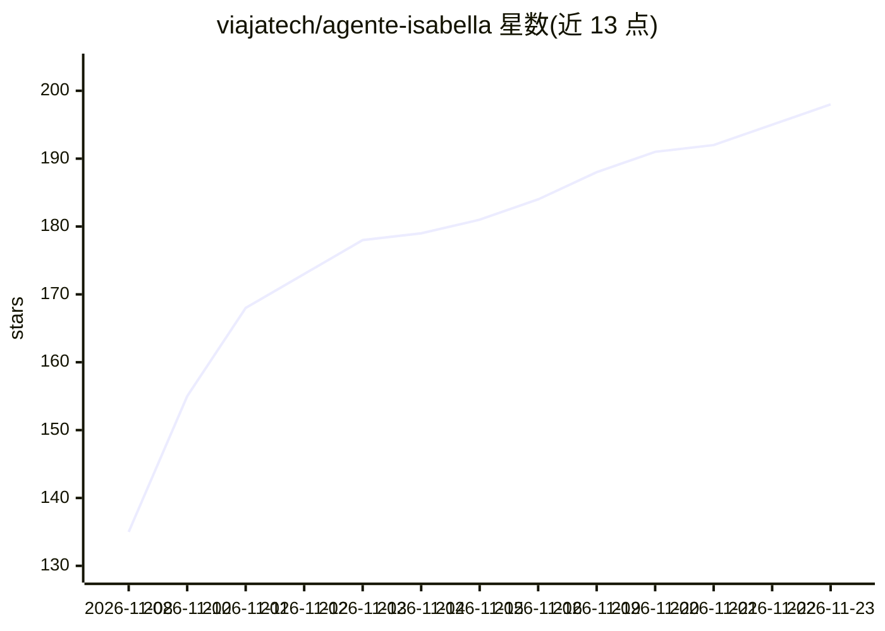

# viajatech/agente-isabella

⭐ 198 · Java · NOASSERTION · 推送 2026-11-02 · [GitHub](https://github.com/viajatech/agente-isabella) · [官网](https://viajatech.com) · 个人维护 · 中文 README

**把 root 安卓手机变成用自己 SIM 打真实电话的 AI 语音助理**

面向消费者的 Android 应用：用机主自己的 SIM 卡拨打电话，并通过 Gemini Live 实时语音（Zephyr 音色）与接听者对话。音频经 Magisk root 后通过 Qualcomm 音频混音器数字注入通话，避免外放与回声。Gemini API 密钥仅存于用户自建的 Cloudflare Worker，由其签发一次性短时效 token，密钥不落手机。首句强制自报 AI 身份，含 8 项用量熔断（按次/分钟/日限额）。安装需 Mac 编译（不用 Gradle/Android Studio），走 AI 编码代理引导的分阶段流程，用户自行提供密钥。测试机型为 Samsung Galaxy A72，其他机型可能需适配混音器。非商业、需署名的自定义许可。

## 筛选速览

| 维度 | 判定 | 备注 |
|---|---|---|
| AI 角色 | `ai-native` | 本体是模型或模型工具 |
| 许可风险 | `none` | NOASSERTION |
| 部署形态 | `library` | 以包/库形式分发 |
| 模型依赖 | — | README 未给出锁定关系 |
| 硬件要求 | — | 无带数字的原话,不猜 |
| 安装摩擦 | `low` | 无编译、无系统依赖或容器化 |
| 成熟度 | — | 结构信号不足 |

## 能力要点

- 用自己 SIM 线路拨打真实电话，Gemini Live 实时语音对话
- 密钥仅存于 Cloudflare Worker，手机端只拿一次性短时效 token
- 8 项熔断：每分钟/每日上限、静默挂断、禁止重连等
- 不用 Gradle/Android Studio，aapt2→javac→d8→apksigner 在 macOS 编译

## 适用场景

- 让 AI 以我的手机号代我拨打电话并实时对话
- 无 root 场景下用无通话模式与 Isabella 语音交流
- 用本地假 Gemini 与本地 Worker 在 Mac 上零成本测试全流程

## 场景标签

`语音 Agent` · 领域:对话与助手

## 证据(README 行号)

> L23: **Isabella Llamadas** es una app Android que marca un número desde **tu propia línea** y conversa en tiempo real co
> L163: **Agente Isabella** turns a rooted Android phone (Android 14+) into an AI voice assistant that places **real phone

## 星数曲线

2026-11-08 135 → 2026-11-23 198（+63）

---
*卡片 v1 · prompt 1.4 · 生成 2026-11-17 · 置信度 mid · 依据 README sha `57802b0f8f93` · [字段定义](../../DATASET.md)*
