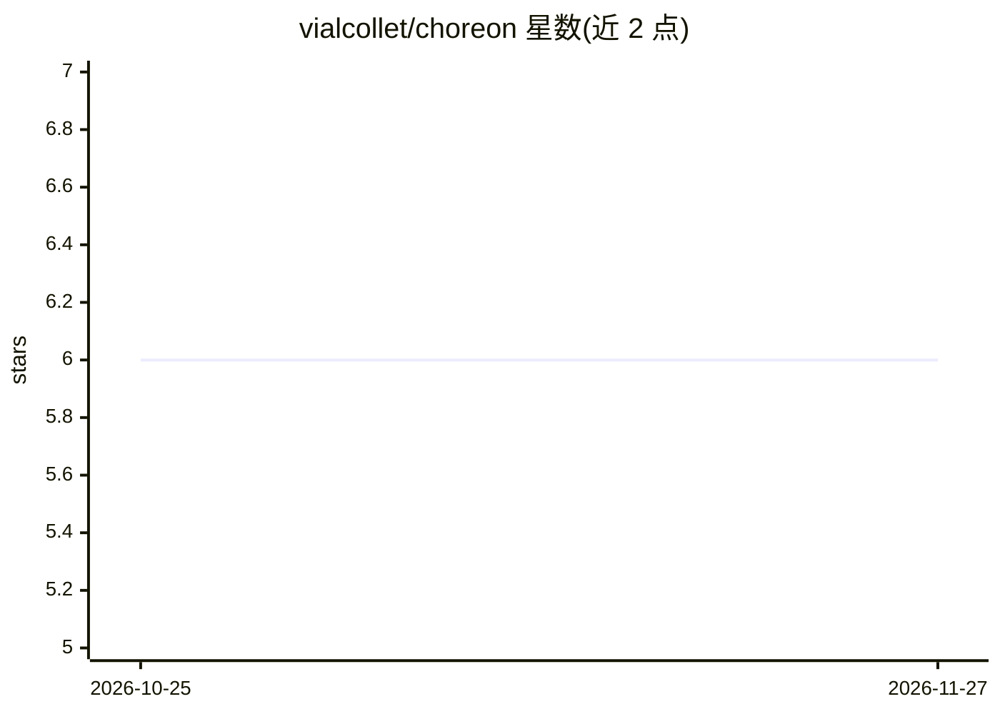

# vialcollet/choreon

⭐ 6 · TypeScript · MIT · 推送 2026-11-23 · [GitHub](https://github.com/vialcollet/choreon) · 个人维护

**面向创作者的 AI 动效视频制作工作室：导演式产出动效影片**

本地运行的开源动效视频生产管线：导演 Agent 先就 13 个维度与用户做立项访谈，生成分镜与参考帧，每个镜头以 scene.html 编码并由无头 Chromium 与 ffmpeg 逐帧渲染；评论 Agent 按六轴打分并自动修复至阈值。配音经 Gemini TTS 录制、Whisper 逐词对时，支持逐帧标注修改、字幕烧录、翻译版本、模板批量静帧广告与导出 DaVinci Resolve。需 Claude 订阅或 Anthropic API key，单机单操作者，不可暴露公网。

## 筛选速览

| 维度 | 判定 | 备注 |
|---|---|---|
| AI 角色 | `ai-native` | 本体是模型或模型工具 |
| 许可风险 | `permissive` | MIT |
| 部署形态 | `library` | 以包/库形式分发 |
| 模型依赖 | locked-api |  |
| 硬件要求 | — | 无带数字的原话,不猜 |
| 安装摩擦 | `medium` | 含编译或系统依赖之一 |
| 成熟度 | — | 结构信号不足 |

## 能力要点

- 立项访谈（13 轴）→ 分镜 → 逐帧代码渲染 → 评论自动修复的完整管线
- Gemini TTS 配音 + Whisper 逐词对时，镜头按词剪辑
- 逐帧画框标注的修改意见自动路由并成为镜头新计划
- 翻译版本、批量静帧广告、导出 DaVinci Resolve

## 适用场景

- 制作产品发布、logo 揭示、UI 演示类动效视频
- 以导演视角通过访谈和标注控制影片产出
- 为社交渠道批量产出竖版带字幕短片
- 对已有影片生成其他语言的翻译版本

## 场景标签

`视频生成` `语音合成` · 领域:内容生成

## 证据(README 行号)

> L32: Choreon is a production pipeline for **motion design videos** (product launches, logo reveals, UI walkthroughs, soc
> L36: - **Shots in code** — each shot is a `scene.html` animated with a small deterministic runtime (critical springs, tw

## 星数曲线

2026-10-25 6 → 2026-11-27 6（+0）

---
*卡片 v1 · prompt 1.4 · 生成 2026-11-20 · 置信度 mid · 依据 README sha `fb6bd9d19f26` · [字段定义](../../DATASET.md)*
