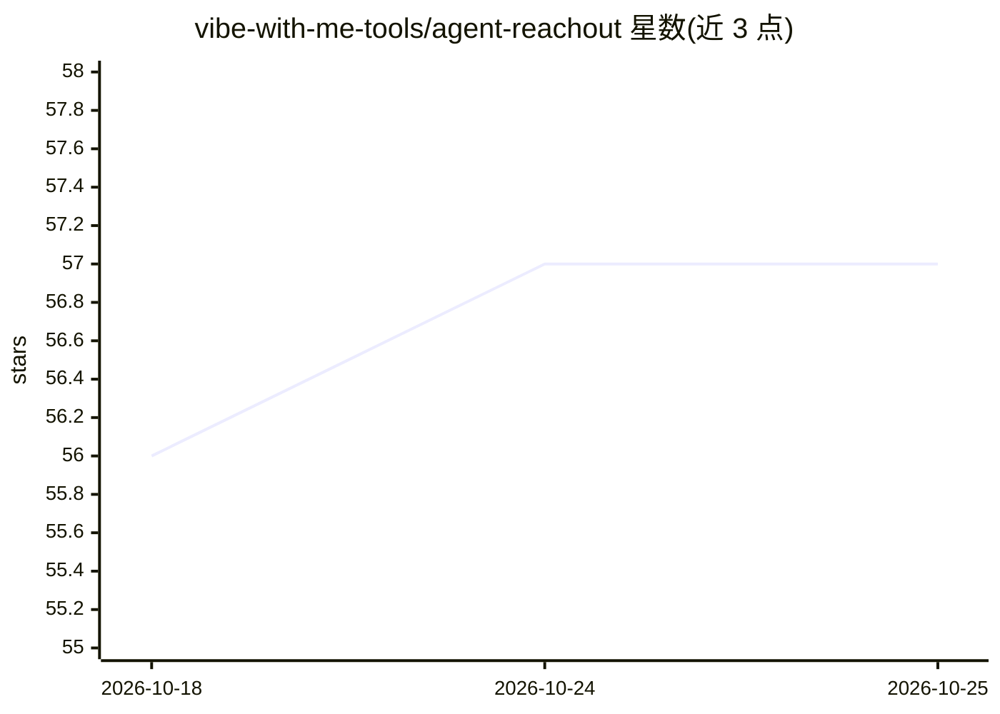

# vibe-with-me-tools/agent-reachout

⭐ 57 · TypeScript · MIT · 推送 2026-03-30 · [GitHub](https://github.com/vibe-with-me-tools/agent-reachout) · 个人维护

**Claude Code 插件：任务完成或需决策时通过 Telegram 通知用户**

实现为 Claude Code 插件的小型桥接工具：当 agent 完成任务、遇到阻塞或需要人工决策时，向用户的 Telegram 发送通知，支持单向通知或双向对话，agent 可暂停等待回复后继续。还可通过 Telegram 消息触发 Claude Code 任务（基于 Agent SDK CLI，任务排队逐一执行，提供 /task、/continue、/resume 等命令）。安装依赖 Bun 与 Claude Code CLI，需配置 Telegram bot token 与 chat ID 环境变量。作者声明这是早期个人工作流工具，非工作流引擎或 agent 编排系统。

## 筛选速览

| 维度 | 判定 | 备注 |
|---|---|---|
| AI 角色 | `ai-ecosystem` | LLM/agent 周边工具 |
| 许可风险 | `permissive` | MIT |
| 部署形态 | `None` |  |
| 模型依赖 | locked-api |  |
| 硬件要求 | — | 无带数字的原话,不猜 |
| 安装摩擦 | `low` | 无编译、无系统依赖或容器化 |
| 成熟度 | `idea` | |

## 能力要点

- 任务完成/阻塞/需决策时发送 Telegram 通知
- 支持双向对话与 agent 暂停→询问→恢复
- 从 Telegram 触发 Claude Code 任务（排队执行，记录会话 ID 支持 /continue）
- 提供 /task、/status、/history、/cancel 等 Telegram 命令

## 适用场景

- 长时间运行的编码任务完成后收到通知
- 在手机上批准 agent 的文件修改或删除操作
- 离开终端时回答 agent 的澄清问题并让其继续
- 通过 Telegram 消息直接发起和续接 Claude Code 任务

## 场景标签

 · 领域:开发工具/agent 通知

## 证据(README 行号)

> L33: Currently implemented as a **Claude Code plugin**.
> L3: Let your Claude Code message you on Telegram when it needs decisions or finishes work, even when you’re away from yo

## 星数曲线

2026-10-18 56 → 2026-10-25 57（+1）

---
*卡片 v1 · prompt 1.4 · 生成 2026-10-24 · 置信度 high · 依据 README sha `3eb3bd77fb47` · [字段定义](../../DATASET.md)*
