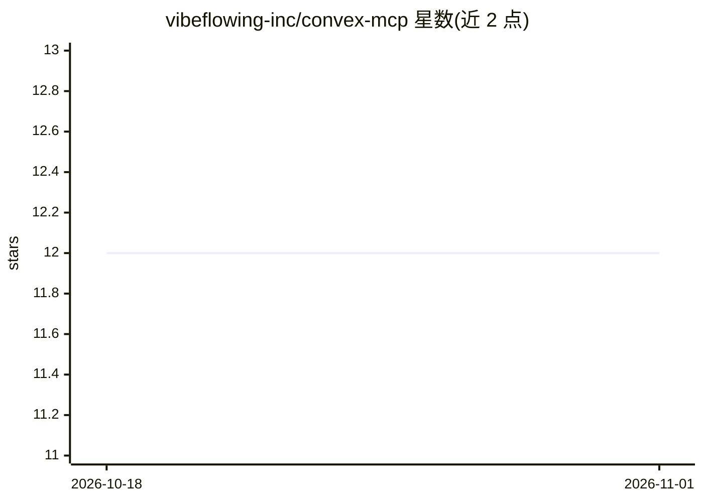

# vibeflowing-inc/convex-mcp

⭐ 12 · TypeScript · MIT · 推送 2026-05-26 · [GitHub](https://github.com/vibeflowing-inc/convex-mcp) · [官网](https://vibeflow.ai/) · 组织维护

**把 Convex 后端函数封装为无状态 MCP 服务器的适配器**

npm 包，将 Convex 后端函数自动翻译为标准 MCP 服务器，使 Claude、Cursor 等 AI agent 能发现并调用这些函数。支持注册工具（Convex 函数→MCP tool）、带 Zod 参数的 MCP prompts、静态与模板化 MCP resources，并提供 bearerAuth Bearer 令牌鉴权。可在 VibeFlow 云端测试。面向使用 Convex 的开发者。

## 筛选速览

| 维度 | 判定 | 备注 |
|---|---|---|
| AI 角色 | `ai-ecosystem` | LLM/agent 周边工具 |
| 许可风险 | `permissive` | MIT |
| 部署形态 | `library` | 以包/库形式分发 |
| 模型依赖 | — | README 未给出锁定关系 |
| 硬件要求 | — | 无带数字的原话,不猜 |
| 安装摩擦 | `low` | 无编译、无系统依赖或容器化 |
| 成熟度 | — | 结构信号不足 |

## 能力要点

- Convex 函数自动转为 MCP 工具
- 支持 MCP prompts（Zod 参数）与静态/模板化 resources
- bearerAuth 提供 Bearer 令牌鉴权

## 适用场景

- 让 Claude、Cursor 等 agent 直接调用我的 Convex 后端函数
- 为 Convex 后端快速搭建 MCP 端点并加鉴权

## 场景标签

 · 领域:AI 基础设施/MCP 适配器

## 证据(README 行号)

> L10: Build a stateless MCP endpoint on top of Convex.
> L12: This package provides a simple wrapper to automatically translate your Convex backend functions into a standard MCP

## 星数曲线

2026-10-18 12 → 2026-11-01 12（+0）

---
*卡片 v1 · prompt 1.4 · 生成 2026-10-31 · 置信度 high · 依据 README sha `7bf99c3769e5` · [字段定义](../../DATASET.md)*
