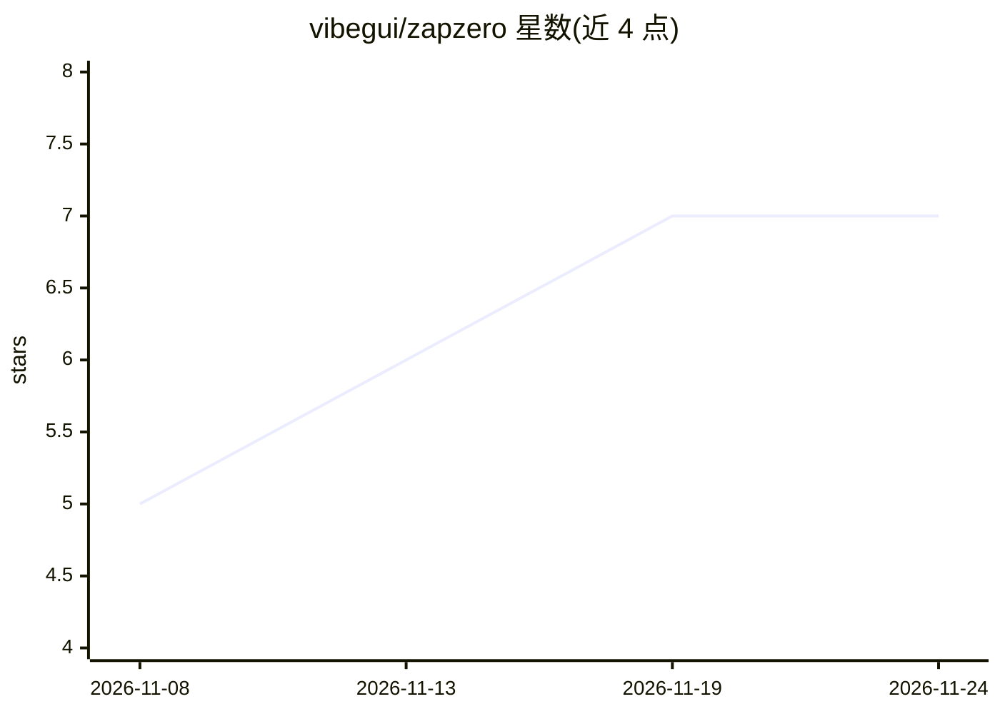

# vibegui/zapzero

⭐ 7 · TypeScript · MIT · 推送 2026-11-16 · [GitHub](https://github.com/vibegui/zapzero) · [官网](https://zapzero.dev) · 个人维护

**macOS 上的 WhatsApp 收件箱清零工具：AI 分诊并代拟回复**

zapzero 以只读方式复制 Mac 上 WhatsApp Desktop 的本地 SQLite 数据库（每 15 分钟快照），用 AI 对每个会话做分诊（紧急度、等待对象、联系人分类）并以用户口吻起草回复；回复被键入 WhatsApp 窗口，由用户按 Enter 发送， Zap 自身不与服务器通信。支持 Claude Code 或本地 Ollama 作后端，可选 OpenRouter 键启用 Jev 分诊；提供 React 面板、键盘操作流、用量统计与本地 MCP 服务，面板支持葡语/英语。仅支持 macOS + WhatsApp Desktop。

## 筛选速览

| 维度 | 判定 | 备注 |
|---|---|---|
| AI 角色 | `ai-native` | 本体是模型或模型工具 |
| 许可风险 | `permissive` | MIT |
| 部署形态 | `None` |  |
| 模型依赖 | local-ok | 支持本地模型 |
| 硬件要求 | — | 无带数字的原话,不猜 |
| 安装摩擦 | `low` | 无编译、无系统依赖或容器化 |
| 成熟度 | — | 结构信号不足 |

## 能力要点

- 只读复制本地 WhatsApp 数据库，无 bot、无关联设备、不经 zapzero 云
- AI 分诊会话分类（Important/本周/Group 等）并按用户语气起草回复
- 通过 claude mcp add 提供本地 MCP 服务与 Claude Code skill
- 可选 Ollama 本地模型，数据不出本机

## 适用场景

- 把 WhatsApp 私人收件箱按紧急度清理到零
- 让 Claude 直接查询'谁在等我回复'或本月回复统计
- 在完全离线（Ollama）模式下处理聊天分诊与草拟

## 场景标签

`AI 助手` · 领域:对话与助手

## 证据(README 行号)

> L9: zapzero reads the WhatsApp Desktop app's own database on your Mac, **read-only**. AI triages every chat (who is wait
> L39: - Claude Code, logged in. zapzero runs it headless (`claude -p`, no tools, no MCP) and your Claude subscription pay
> L40: - Or a local model with Ollama: nothing leaves your Mac. Setup asks which AI to use, and the panel language (Portug

## 星数曲线

2026-11-08 5 → 2026-11-24 7（+2）

---
*卡片 v1 · prompt 1.4 · 生成 2026-11-20 · 置信度 high · 依据 README sha `88a8b47183c8` · [字段定义](../../DATASET.md)*
