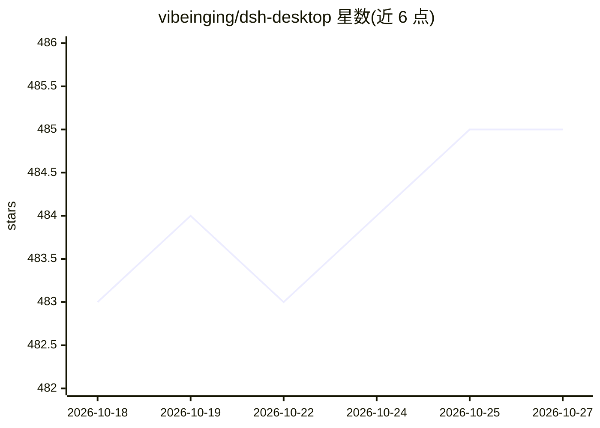

# vibeinging/dsh-desktop

⭐ 485 · JavaScript · MIT · 推送 2026-10-26 · [GitHub](https://github.com/vibeinging/dsh-desktop) · 个人维护 · 中文 README

**DeepSeek Harness 的桌面发行版：打包官方 Web、插件市场与桌面能力**

社区维护的 Electron 桌面应用：直接运行官方 DeepSeek Harness npm 运行时与官方 dsh-web-app，在单一 DSH Profile 中提供对话、Agent、文件树、Git、终端、Worktree 与插件市场，并预装 16 个固定版本、带权限声明的默认 Bundle（含手机远程、会话窗口团队、Office 工具等）。Electron 层仅作为薄桌面 Host，插件状态以官方 Profile 为唯一权威。macOS Apple Silicon 与 Windows 提供安装包，Linux AppImage 处于测试邀请阶段；手机远程依赖第三方账号、信令与中继服务。

## 筛选速览

| 维度 | 判定 | 备注 |
|---|---|---|
| AI 角色 | `ai-ecosystem` | LLM/agent 周边工具 |
| 许可风险 | `permissive` | MIT |
| 部署形态 | `desktop` | 安装包/桌面程序 |
| 模型依赖 | — | README 未给出锁定关系 |
| 硬件要求 | — | 无带数字的原话,不猜 |
| 安装摩擦 | `low` | 无编译、无系统依赖或容器化 |
| 成熟度 | `idea` | |

## 能力要点

- 直接运行官方 DSH 运行时与官方 Web，不维护私有 Chat 分叉
- 新 Profile 预装 16 个固定版本 Bundle，均可停用或卸载
- 手机远程：出站连接、Noise IK 加密，支持 Remote Web/Android/另一台 Desktop
- 插件市场集成于官方设置页，与官方 CLI 操作同一 Profile

## 适用场景

- 在桌面一站式使用 DeepSeek Harness 的对话与 Agent 并管理插件
- 从手机或浏览器远程继续同一 Workspace 和 Session
- 在隔离的 Git Worktree 中开展多会话工作

## 场景标签

`AI 助手` · 领域:对话与助手

## 证据(README 行号)

> L18: DSH Desktop（插件集成版 / Bundle Edition）是一个社区维护的桌面发行版。它直接运行官方 DeepSeek Harness npm 运行时与官方 `dsh-web-app`，并预装一组经过固定和验证的社区 
> L123: Electron 在这里是一层很薄的桌面 Host。真正的 Agent、会话和插件系统仍属于 DSH；项目自己的功能也尽量拆成 Bundle。这样，portable 插件可以同时安装到兼容的官方 Web 和 DSH Deskto

## 星数曲线

2026-10-18 483 → 2026-10-27 485（+2）

---
*卡片 v1 · prompt 1.4 · 生成 2026-10-21 · 置信度 mid · 依据 README sha `caa05d7af8a5` · [字段定义](../../DATASET.md)*
