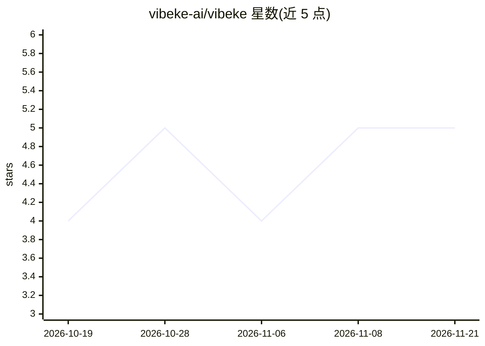

# vibeke-ai/vibeke

⭐ 5 · Rust · Apache-2.0 · 推送 2026-11-20 · [GitHub](https://github.com/vibeke-ai/vibeke) · [官网](https://vibeke.dev) · 组织维护

**终端中运行多个 agent CLI 的工作区，可从手机回复请求**

Vibeke 是一个终端多路复用器式的工作区，把 Claude Code、Codex 等 agent CLI 汇聚到同一环境，在本地或 SSH 主机上运行。核心机制：统一 inbox 收集各 agent 的提问与权限请求（可在终端或配对的手机/浏览器回复）、holder 进程使 agent 在客户端断开或服务器重启后继续运行、支持 pane 间 @mention 互发请求、浏览器页面向 agent 发送标注与截图。通过 install.sh 安装 host CLI，另有桌面应用连接主机。

## 筛选速览

| 维度 | 判定 | 备注 |
|---|---|---|
| AI 角色 | `ai-ecosystem` | LLM/agent 周边工具 |
| 许可风险 | `permissive` | Apache-2.0 |
| 部署形态 | `None` |  |
| 模型依赖 | — | README 未给出锁定关系 |
| 硬件要求 | — | 无带数字的原话,不猜 |
| 安装摩擦 | `low` | 无编译、无系统依赖或容器化 |
| 成熟度 | — | 结构信号不足 |

## 能力要点

- 统一 inbox 集中各 agent 的提问与权限请求，支持手机/浏览器配对回复
- holder 进程保障 agent 在客户端断开或服务器重启后继续运行
- agent 间 @mention 协作（Claude Code 与 Codex 集成）
- 浏览器页面向 agent 发送元素标注与截图

## 适用场景

- 在同一终端工作区并行运行多个编码 agent
- 离开电脑时用手机回复 agent 的权限与提问请求
- 在 SSH 主机上运行 agent 并在本地预览其应用

## 场景标签

`编码 Agent` · 领域:编码与开发

## 证据(README 行号)

> L7: Bring Claude Code, Codex, and your other agent CLIs into one workspace.
> L95: - **Agent integrations.** Use Claude Code, Codex, pi, omp, OpenCode, Hermes Agent, Gemini CLI, or an ACP agent. Str
> L101: Vibeke runs inside your terminal.

## 星数曲线

2026-10-19 4 → 2026-11-21 5（+1）

---
*卡片 v1 · prompt 1.4 · 生成 2026-11-21 · 置信度 high · 依据 README sha `3f01ac7c6aee` · [字段定义](../../DATASET.md)*
