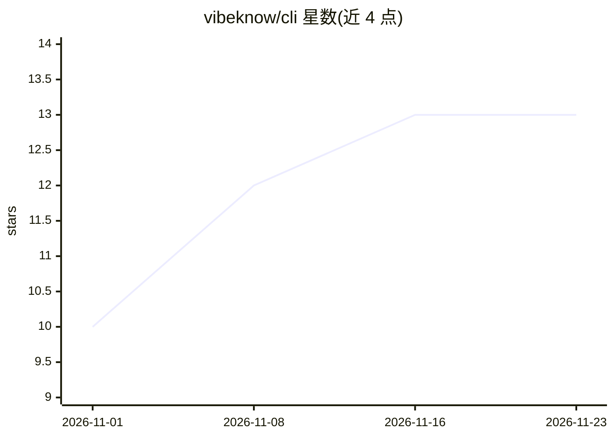

# vibeknow/cli

⭐ 13 · Go · MIT · 推送 2026-10-29 · [GitHub](https://github.com/vibeknow/cli) · [官网](https://vibeknow.ai) · 组织维护 · 中文 README

**文档/网页一键生成视频的 CLI，为人类与 AI Agent 设计**

VibeKnow 官方命令行工具：从文件、URL 或文档 ID 一步生成视频，覆盖文档解析、脚本生成、TTS、场景设计、渲染与打包。渲染由后端服务完成，CLI 负责任务提交、SSE 进度跟踪、凭证管理与结果下载。内置 3 个开放 Agent Skills 格式的技能，声明兼容 Claude Code、Cursor 等 agent 运行时；认证支持浏览器 Device Flow、两阶段 Agent 流程、PAT 与环境变量。计费功能（导出 MP4、改写配音）经确认门控。

## 筛选速览

| 维度 | 判定 | 备注 |
|---|---|---|
| AI 角色 | `ai-native` | 本体是模型或模型工具 |
| 许可风险 | `permissive` | MIT |
| 部署形态 | `library` | 以包/库形式分发 |
| 模型依赖 | — | README 未给出锁定关系 |
| 硬件要求 | — | 无带数字的原话,不猜 |
| 安装摩擦 | `medium` | 含编译或系统依赖之一 |
| 成熟度 | — | 结构信号不足 |

## 能力要点

- 一条命令完成文档到视频：解析、脚本、TTS、渲染、打包
- 内置 3 个 SKILL.md 技能，auto-detect 本地 agent 并 symlink 安装
- 两阶段 Device Flow 让 Agent 无人值守运行，JWT 环境变量支持 CI
- 单镜头旁白改写与重新配音，计费前经确认门控并显示 diff

## 适用场景

- 把 PDF 报告或文章链接转成可分享的视频
- 让 AI Agent 通过技能自动批量生成视频
- CI 容器环境用预签发 JWT 调用视频生成
- 只改一句旁白而不整片重新生成

## 场景标签

`视频生成` `文档解析` `语音合成` · 领域:内容生成

## 证据(README 行号)

> L9: The official VibeKnow CLI tool — built for humans and AI Agents. Turn documents, URLs, and files into professional v
> L16: - **Agent-Native Design** — 3 structured Skills out of the box, compatible with Claude Code, Cursor, and other AI t

## 星数曲线

2026-11-01 10 → 2026-11-23 13（+3）

---
*卡片 v1 · prompt 1.4 · 生成 2026-11-18 · 置信度 high · 依据 README sha `c7ff764d17d3` · [字段定义](../../DATASET.md)*
