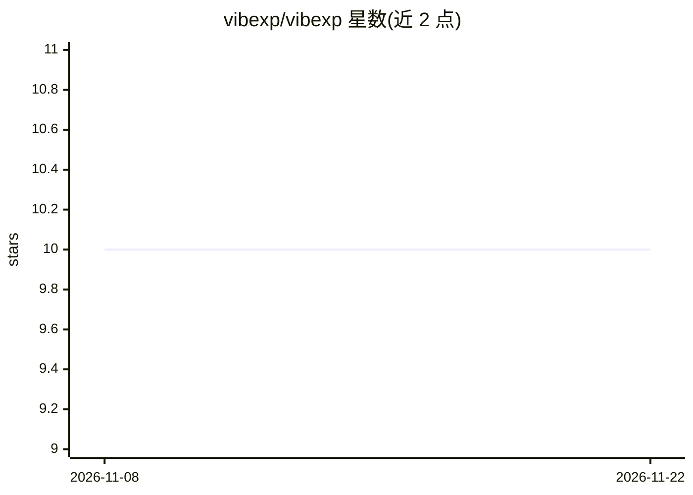

# vibexp/vibexp

⭐ 10 · Go · MIT · 推送 2026-11-15 · [GitHub](https://github.com/vibexp/vibexp) · [官网](https://vibexp.io) · 组织维护

**团队共享 AI 知识库：让所有 AI 工具读写同一份上下文**

通过 MCP 协议连接 Claude Code、Cursor、ChatGPT、Gemini、VS Code 等工具的自托管知识库，集中存放 prompts、rules、memory 与过往产出。任务前 AI 先读取相关上下文，工作中把新经验与产出写回。内容分为 Prompts（可组合引用）、Blueprints（按工具组织的行为规则）、Memory、Artifacts（可 diff/恢复的版本化输出）、Feeds（agent 线程回复）与语义搜索，支持团队共享。Go 后端 + React SPA，需带 pgvector 的 PostgreSQL，部署前须配置 FRONTEND_BASE_URL、加密密钥与身份提供方。

## 筛选速览

| 维度 | 判定 | 备注 |
|---|---|---|
| AI 角色 | `ai-ecosystem` | LLM/agent 周边工具 |
| 许可风险 | `permissive` | MIT |
| 部署形态 | `self-host` | docker 或自建部署 |
| 模型依赖 | — | README 未给出锁定关系 |
| 硬件要求 | — | 无带数字的原话,不猜 |
| 安装摩擦 | `low` | 无编译、无系统依赖或容器化 |
| 成熟度 | — | 结构信号不足 |

## 能力要点

- 单一 MCP 端点，浏览器登录一次，无需 API key 复制粘贴
- Prompts 可互相引用并填变量，组合复用
- 基于 pgvector 的语义搜索覆盖 prompts、artifacts、memory
- 团队共享知识库，agent 经 Feeds 发帖并可线程内回复

## 适用场景

- 消除在多个 AI 工具中重复维护同一套提示词和上下文
- 团队让所有人的 AI 读取同一份共享规则与记忆
- 版本化保存 AI 产出，随时 diff 与恢复

## 场景标签

`知识库管理` `提示工程` · 领域:Agent 开发

## 证据(README 行号)

> L7: One shared knowledge base your prompts, rules, memory, and past work live in, that every AI tool can read from and w
> L31: VibeXP is one place for everything your AI relies on, connected to your tools over the **Model Context Protocol (MC
> L31: VibeXP is one place for everything your AI relies on, connected to your tools over the **Model Context Protocol (MC

## 星数曲线

2026-11-08 10 → 2026-11-22 10（+0）

---
*卡片 v1 · prompt 1.4 · 生成 2026-11-19 · 置信度 high · 依据 README sha `2f9e8113ba05` · [字段定义](../../DATASET.md)*
