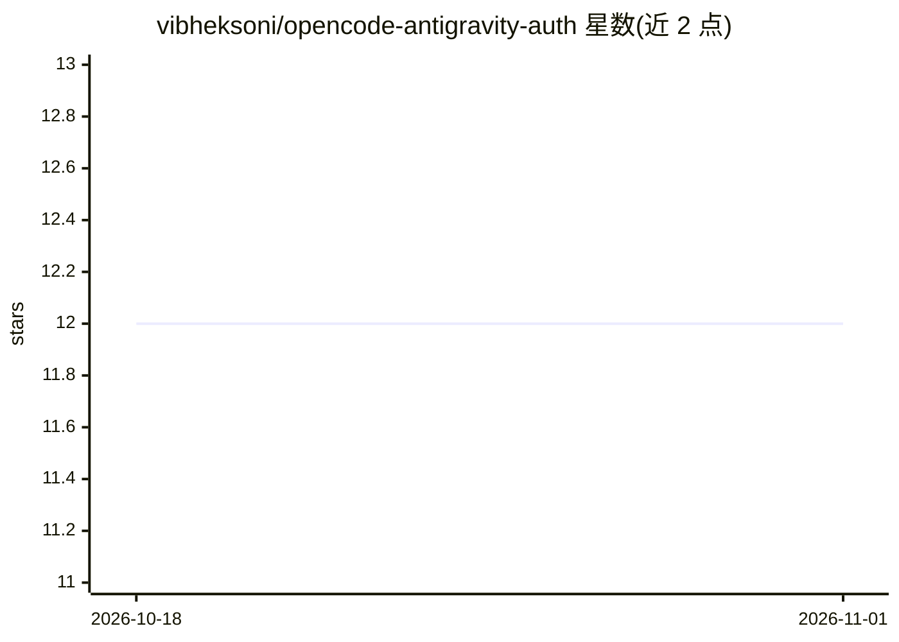

# vibheksoni/opencode-antigravity-auth

⭐ 12 · TypeScript · MIT · 推送 2026-04-20 · [GitHub](https://github.com/vibheksoni/opencode-antigravity-auth) · 个人维护

**OpenCode 插件：Antigravity 账号认证、轮换与配额管理**

面向 OpenCode（Windows 为主）的 Antigravity 接入插件：提供 Google OAuth 登录、多账号存储与轮换、配额查询、账号校验，并从已安装的 Antigravity 应用提取运行时元数据（OAuth client、语言服务器二进制），以 headless bridge 方式调用 bridge-backed 模型。提供 /ag-accounts TUI 管理界面与独立 Bun 命令行助手。要求 Node.js 20+，可选 Bun 与已安装的 Antigravity 应用；通过 git clone + npm install/build 或 OpenCode 插件安装器安装。

## 筛选速览

| 维度 | 判定 | 备注 |
|---|---|---|
| AI 角色 | `ai-ecosystem` | LLM/agent 周边工具 |
| 许可风险 | `permissive` | MIT |
| 部署形态 | `library` | 以包/库形式分发 |
| 模型依赖 | — | README 未给出锁定关系 |
| 硬件要求 | — | 无带数字的原话,不猜 |
| 安装摩擦 | `low` | 无编译、无系统依赖或容器化 |
| 成熟度 | — | 结构信号不足 |

## 能力要点

- Google OAuth 登录与多账号存储、轮换、配额检查
- 读取已安装 Antigravity 应用的运行时元数据与语言服务器二进制构建 headless bridge
- /ag-accounts TUI 账号管理器与独立 bun 命令行助手
- 双层配置：opencode.json 元组选项 + antigravity.json 运行时配置

## 适用场景

- 在 OpenCode 中用 Google 账号登录并接入 Antigravity 模型
- 多个 Antigravity 账号之间轮换并监控配额
- 从 TUI 将模型定义写入 opencode.json

## 场景标签

`模型网关` · 领域:Agent 开发

## 证据(README 行号)

> L3: Antigravity auth, account management, quota inspection, runtime metadata extraction, and bridge support for OpenCode
> L22: - Google OAuth login for Antigravity-compatible accounts
> L25: - Bridge support for the Antigravity language server and headless flows

## 星数曲线

2026-10-18 12 → 2026-11-01 12（+0）

---
*卡片 v1 · prompt 1.4 · 生成 2026-10-31 · 置信度 high · 依据 README sha `3314514ff384` · [字段定义](../../DATASET.md)*
