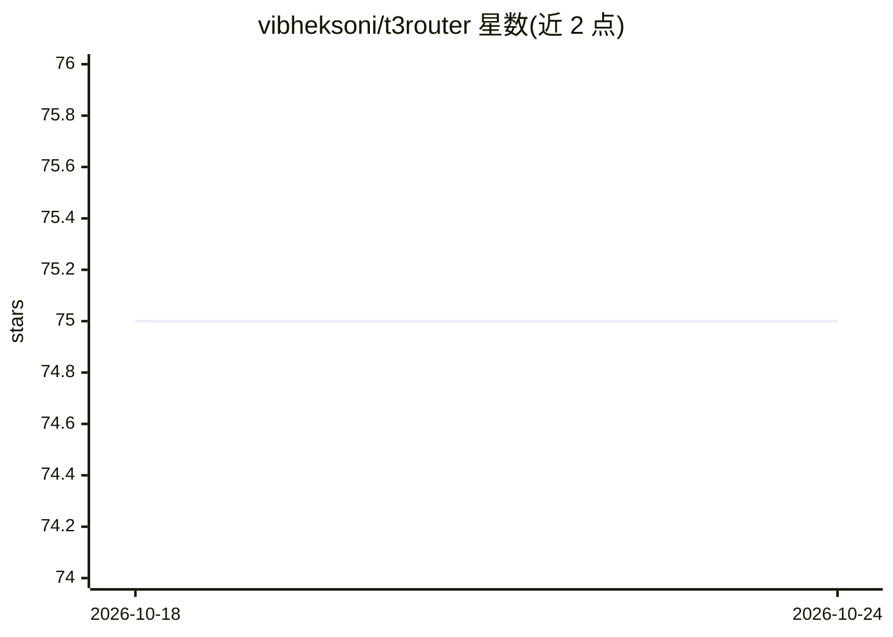

# vibheksoni/t3router

⭐ 76 · Rust · MIT · 推送 2026-07-25 · [GitHub](https://github.com/vibheksoni/t3router) · 个人维护

**在终端调用 t3.chat 上 51+ 模型的 Rust 客户端库**

面向 Rust 开发者与终端用户的 t3.chat 客户端库：用浏览器 cookie 认证（需付费订阅），可在终端 REPL 或程序中调用 Claude、GPT、Gemini、Grok、DeepSeek 等 51+ 模型，支持流式输出、多轮对话、图像生成、余额与信用点追踪、会话持久化及模型状态/基准查询。通过 wreq 模拟 Chrome 136 TLS 指纹、动态解析 JS bundle 发现模型；不适用于免费账户，cookie 会过期。附带 pi-t3chat 扩展将模型接入 Pi 编码 agent。

## 筛选速览

| 维度 | 判定 | 备注 |
|---|---|---|
| AI 角色 | `ai-ecosystem` | LLM/agent 周边工具 |
| 许可风险 | `permissive` | MIT |
| 部署形态 | `library` | 以包/库形式分发 |
| 模型依赖 | — | README 未给出锁定关系 |
| 硬件要求 | — | 无带数字的原话,不猜 |
| 安装摩擦 | `low` | 无编译、无系统依赖或容器化 |
| 成熟度 | — | 结构信号不足 |

## 能力要点

- 51+ 模型访问（Claude/GPT/Gemini/Grok/DeepSeek/Llama/Qwen 等）与图像生成
- send_with_credits() 精确追踪每次请求扣除的信用点
- send_stream() 基于 SSE 的逐 token 流式输出，会话自动保存/恢复
- TLS 指纹模拟（Chrome 136）与动态模型发现（解析 t3.chat JS bundle）

## 适用场景

- 在终端直接使用已付费的 t3.chat 订阅聊天
- 在 Rust 程序中集成多模型调用与用量追踪
- 把 t3.chat 模型接入 Pi 编码 agent 并支持工具调用

## 场景标签

`模型网关` `图像生成` · 领域:Agent 开发

## 证据(README 行号)

> L3: A Rust library that lets you use t3.chat from your terminal and integrate it into your programs.
> L13: So I built this library. It uses your t3.chat cookies to authenticate and lets you chat with any model, manage conv
> L32: - **Interactive CLI** - `cargo run --bin t3chat` for a terminal REPL with `/help`, `/new`, `/resume`, `/save`, `/mo

## 星数曲线

2026-10-18 75 → 2026-10-24 75（+0）

---
*卡片 v1 · prompt 1.4 · 生成 2026-10-24 · 置信度 high · 依据 README sha `f62d6f24ccef` · [字段定义](../../DATASET.md)*
